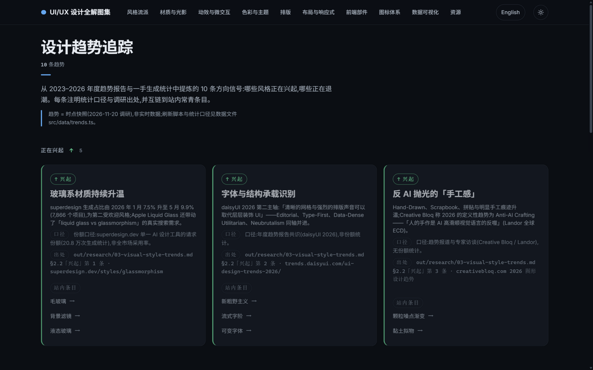
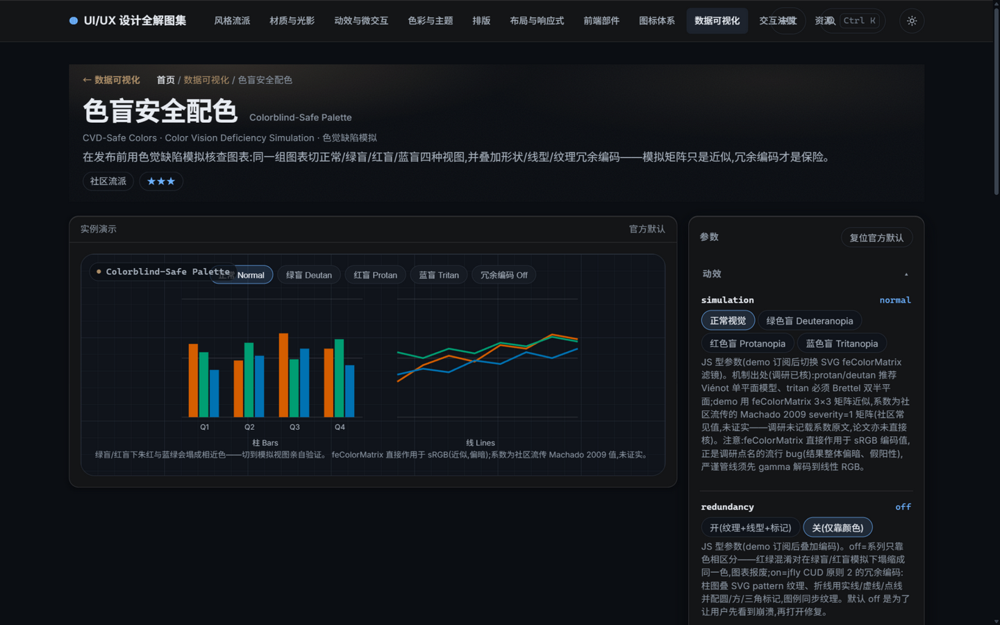
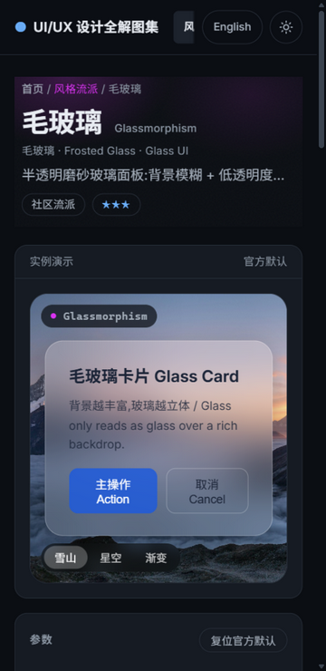

[简体中文](README.md) | English

<div align="center">

# uiux-atlas · UI/UX Design Atlas

**For AI-coding users · Modern UI/UX design explained · Astro+React parameterized playground · Structured replication prompts**

[](#-tech-stack)
[](#-what-is-this)
[](#-license)

> The design language and inspiration come from five lines of design research (Apple HIG / TDesign / ByteDance Arco+Semi / gallery trends / reusable code); the full decision record lives in [docs/design-spec.md](docs/design-spec.md).

</div>

> [!IMPORTANT]
> This is a **design learning atlas** — not a component library, and not production-grade component source. Every entry demo is a **teaching implementation**: simplified to explain the mechanism, and not meant to be copied into production as-is.

> [!WARNING]
> Platform-proprietary materials — Fluent Acrylic / Fluent Mica / Liquid Glass / SwiftUI materials, etc. — are **approximated** in the web demos. Values the platform does not publish (or publishes only partially) are honestly labeled "community approximation" inside the entries; see `materials/fluent-acrylic`, `materials/liquid-glass`, `materials/swiftui-materials` and the corresponding entries.

> [!CAUTION]
> Official values and browser-support statements in the entries were verified at research time on **2026-11-20/21**. Specs and platform docs drift; always re-check the official docs. Every entry's `schema.json` carries first-hand source URLs (the `sources` field).

> [!NOTE]
> Fully static site: no backend, no accounts, no tracking, no data upload. All interactions (parameter tuning, prompt generation, theme switching) run locally in your browser.

## 📖 What is this

uiux-atlas breaks modern frontend UI/UX knowledge into **81 entries × 9 categories** (styles 7 / materials 12 / motion 11 / color 9 / type 3 / layout 1 / components 24 / icons 8 / dataviz 6; parameterization star distribution 3★ 47 / 2★ 33 / 1★ 1). Every entry is built from four elements: **① live example** (a React-island demo that updates as you tweak), **② code breakdown** (bilingual four-part walkthrough: DOM structure / styles & params / motion & interaction / parameter sensitivity), **③ real-time parameter panel** (controls auto-generated from the entry's `schema.json`), and **④ one-click replication prompt** (the current parameter snapshot condensed into a structured prompt — the "Copy replication prompt" button hands it to any AI agent).

The entry data model is a three-file trio under `src/content/entries/{category}/{slug}/`:

| File | Content |
|---|---|
| `schema.json` | Metadata + parameter contract: name (incl. Chinese `nameZh`), category, source system, parameterization star (1–3★), params (6 types), use/avoid scenarios, a11y, browser support, fallback, `sources` (first-hand URLs), `promptTemplate` |
| `zh.mdx` / `en.mdx` | Bilingual body, four-part h2 breakdown, rendered into the entry page |
| `demo/Demo.tsx` | Interactive demo (React island), sharing one store with the parameter panel |

## 📸 Screenshots

**All nine screenshots are real running captures, not mockups**: taken on 2026-11-21/22 against a production build (`pnpm -C uiux-atlas run build` + preview) served at `localhost:4321` (eight were re-captured on 2026-11-22; the dataviz one dates from the evening of 2026-11-21). To reproduce each shot: run `pnpm -C uiux-atlas dev` and open the "Reproduce at" URL from the table — every image reproduces from that same URL. Note: the 6 updated and 3 new screenshots were committed with `a170451` (2026-11-22, feat(theme): light-theme modernization v2.5); `git status` no longer shows any uncommitted screenshots.

| Theme | Page | Screenshot | Reproduce at |
|---|---|---|---|
| Dark | Home (live hero demo + bento) |  | `http://localhost:4321/` |
| Light | Home |  | `http://localhost:4321/` (switch to light) |
| Dark | Entry styles/glassmorphism (demo + param panel) |  | `http://localhost:4321/styles/glassmorphism/` |
| Light | Entry styles/glassmorphism |  | `http://localhost:4321/styles/glassmorphism/` (switch to light) |
| Dark | Entry components/nav-menu (top nav + avatar hover menu) |  | `http://localhost:4321/components/nav-menu/` |
| Light | Resources (30 links × five groups) |  | `http://localhost:4321/resources/` |
| Dark | Trend-tracking page (rising/cooling + caveat notes) |  | `http://localhost:4321/trends/` |
| Dark | Entry dataviz/dataviz-colorblind-safe (four colorblind-simulation views) |  | `http://localhost:4321/dataviz/dataviz-colorblind-safe/` |
| Dark | Entry, mobile 360px (demo first, panel follows) |  | `http://localhost:4321/styles/glassmorphism/` (360px viewport) |

## ✨ Features

| Feature | Status | Notes |
|---|---|---|
| 81 bilingual entries across nine categories | ✅ | 81 entries × zh/en = 162 MDX bodies; bilingual three-layer routing (zh unprefixed, en under `/en/`) plus the resources and trends pages — `astro build` emits 186 pages (measured this session). **Entry/MDX scale: this row + the `verify-entries` gate measurement is the authoritative figure** (measured this repair run: `{"expected":81,"found":81,"problems":0}`); the "43 entries × 86 MDX" in `docs/design-spec.md`'s header and appendix is an MVP-era leftover never backfilled by later version bumps and is not the scale figure (see the Design-system section note) |
| Parameter panel | ✅ | Controls auto-generated from the entry's `schema.json` params contract: sliders / OKLCH 4-axis / bézier curve editor / segmented buttons / per-layer shadow; with "reset to official defaults" |
| One-click replication prompt | ✅ | `store.exportSnapshot()` + `buildPrompt` condense the snapshot into a structured prompt; the "Copy replication prompt" button copies it to any AI agent. Live-fire test: HTML produced by a replication agent from the prompt alone hits **7/7** key parameters (threshold ≥5/7, `scripts/verify-prompt-test.mjs`; re-ran this session, 7/7) |
| AI-agent channel (llms.txt + per-entry .md) | ✅ | `src/pages/llms.txt.ts` static endpoint: site positioning + nine categories + the full entry list (name / nameZh / URL / en page / md link); every entry also ships a plain-text `/{category}/{slug}/index.md` (`src/pages/[category]/[slug]/index.md.ts`). Measured this session: `dist/llms.txt` emitted (114 lines), `dist/styles/glassmorphism/index.md` present |
| MCP server (four tools) | ✅ | `mcp/server.mjs`: a zero-dependency stdio JSON-RPC server (per MCP spec 2025-03-26: initialize handshake with version negotiation, tools/list / tools/call, JSON-RPC batching), read-only over each entry's `schema.json`; four tools — `search_entries` / `get_entry` / `build_prompt` / `list_categories` (build_prompt serializes params with the same code as the site's "Copy replication prompt"); coding agents (Claude/Cursor etc.) connect via `node mcp/server.mjs`. Gate `test:mcp`: four assertions over initialize → tools/list → tools/call; measured this session: 4/4 pass (negotiated protocol 2025-03-26) |
| shadcn registry (24 items) | ✅ | the 24 frontend-component demos published inline as shadcn registry items + an index (`public/registry/`, 24 items + index.json = 25 files; shipped as static `dist/registry/` after `pnpm run build`, directly pullable by the shadcn CLI / compatible clients); gate `verify:registry`, measured this session `{"expected":24,"items":24,"problems":0}`; usage under "Deployment → Registry usage (agent consumption)" |
| Open in v0 | ✅ | the entry-page "Open in v0" secondary button (`src/components/PromptExport.tsx`): `encodeURIComponent`s the current replication prompt into `https://v0.dev/chat?q=…` and opens it in a new tab, prefilled. URL-scheme provenance: the official URL-parameter docs are gone (nothing in today's v0.app/docs or vercel.com/docs/v0), so the scheme was verified behaviorally on 2026-11-21 via curl (the 307 redirect chain `v0.dev/chat → v0.app` preserves `q` end to end; the final page's RSC payload contains the prefilled prompt) — an **officially unendorsed, behavior-verified** scheme; if it breaks, fall back to "copy the prompt + open the v0 home page" (evidence chain in that file's header comment) |
| Parameter-snapshot share link | ✅ | `src/lib/shareLink.ts` serializes the current snapshot as `#s=name=value&…` appended to the address; the "Share parameter link" button copies the full link (`src/components/PromptExport.tsx`); opening the link, `DemoStage` parses and restores it on mount — only params present in the schema are restored, invalid values filtered, numbers clamped to min/max |
| Embedded contrast checker | ✅ | `src/components/ContrastChecker.tsx` renders as an extra panel inside the demo stage of two color entries (`color/oklch-workflow` / `color/wcag-contrast`, see `src/components/DemoStage.tsx`): WCAG contrast ratio computed live for foreground/background (`src/lib/color.ts` `contrastRatio`, same implementation as the wcag-contrast entry) |
| @property type constraints | ✅ | `src/styles/global.css` declares `@property` types for the dogfooded styles/glassmorphism parameter variables (`--glass-blur` / `--glass-fill` / `--glass-border` / `--glass-radius`) — typed fallbacks even when a variable is unset; unsupported browsers skip the whole rule; the count-up entry's `--num` does the same |
| Dark & light themes | ✅ | Dark by default, light as a full first-class citizen (same semantic layer, per-theme values); `localStorage("atlas-theme")` persistence + head anti-flash script + dual `theme-color` meta; the two theme token sets pass the contrast gate 12/12 |
| Resources navigator | ✅ | `/resources/` and `/en/resources/`: 30 resources × five groups (official specs / component libraries / interaction & motion tools / inspiration galleries / deep-dive docs), all real URLs, whole-card external links |
| Trend-tracking page | ✅ | `/trends/` and `/en/trends/` (`src/pages/trends.astro` + `src/data/trends.ts`): a point-in-time snapshot of 2023–2026 rising/cooling design trends, distilled entry by entry from `out/research/03-visual-style-trends.md` §2 with per-item provenance and caveat notes (share figures labeled "request share within one AI design tool, not market adoption"); `relatedEntries` in-page links carry a build-time guard — a hardcoded dead link fails the build; measured this session: both pages emitted (`dist/trends/`, `dist/en/trends/`) |
| Platform-proprietary materials | ⚠️ | Web approximations: `liquid-glass` (refraction via SVG `feDisplacementMap`), `fluent-acrylic` (blur radius unpublished; 24px is a common community approximation), `swiftui-materials` (six opacity/blur tiers are a community approximation table — official values unpublished) — annotated in place inside each entry |
| SwiftUI API surface | ⚠️ | `swiftui-spring`, `swiftui-materials` etc. are **comparison demos**: the web side conveys parameter semantics and trends; on-device rendering is the source of truth |
| Code breakdown | ⚠️ | MVP form = highlighted code + per-section commentary (bilingual MDX, four h2 parts; `BreakdownTabs.tsx` groups content by h2 into tabs); the full four-part teaching narrative (breakdown↔content linkage) is not done yet — see the unchecked roadmap item |
| Prompt validation | ⚠️ | **Local proxy metric**: 7 regex checks + threshold ≥5/7, an internal regression baseline — not a cross-agent public benchmark (no external standard for prompt quality; the blueprint records this as engineering inference) |

### Deliberately not built (❌)

- **Backend / accounts / cloud sync**: fully static, zero server — a learning atlas needs no account system or cloud state; adding one would break the "fully static, no tracking" promise (see the NOTE at the top).
- **Live design-trend scraping**: content is a 2026-11-20/21 research snapshot; no live trend scraping. The trend-tracking page (✅ row above) ships as a point-in-time snapshot and **scripted refresh is pending** (recipe: re-run the `out/research/03` web-research flow and replace the numbers in `src/data/trends.ts`; caveat wording and source text follow that study — see "quarterly refresh automation" in the roadmap).

### Invalid-input contract

Entry data is not lenient input: every `schema.json` passes the zod contract in `src/lib/schema.ts` (wired into Astro content collections via `src/content.config.ts`) — **any non-conforming field fails `astro build`; nothing is silently ignored**. On top of that, `scripts/verify-entries.mjs` runs an independent machine re-check (81-entry expected inventory, non-empty bilingual fields, `sources` must be http(s) URLs, per-type params shape, `nameZh` coverage); any problem → `exit 1`.

## 🧰 Tech stack

| Layer | Choice | Rationale (see design-spec) |
|---|---|---|
| Framework | Astro 5 (`^5.7`, measured 5.18.2) | Content site, mostly static; demos/panel/filters hydrate as needed as islands; built-in bilingual i18n routing (zh unprefixed, en `/en/`); content collections validate entry data. Choice follows the blueprint's "Plan C: Astro + token pipeline" |
| UI runtime | React 19 islands | Demo components, param panel, filter bar, tabs, hero mini-demo are React islands; same runtime generation as motion v12 |
| Motion | `motion` ^12 | JS-typed params (spring family) driven directly by the same store; JS springs use the official default bounce 0.25 / damping 10 (spec §2.6); static effects are always zero-JS pure CSS (spec §6c porting rules) |
| Data validation | `zod` ^3.24 | Entry schema contract (per-type checks for 6 param types); invalid input → build failure (contract above) |
| Styling | Native CSS semantic tokens (single file `src/styles/global.css`) | Both themes share the semantic layer, values per theme (spec §2.1); no Tailwind, no CSS-in-JS — design tokens are the single source of truth (spec §2 full tables) |
| Fonts | Self-hosted @fontsource: Inter Variable + Noto Sans SC (400/500/700) | No SF Pro (licensing and cross-platform consistency, spec §2.2); JetBrains Mono is **not bundled** — it is only the first choice of `--font-mono`, falling back to system monospace |

## 🚀 Quick start

Prerequisites: Node ≥ 18.17 (Astro 5 baseline), pnpm ≥ 7.1 (or npm ≥ 9.6.5) — these numbers come from the **astro package's engines declaration** (this repo pins `astro@5.18.2`, whose engines are `node 18.20.8 || ^20.3.0 || >=22.0.0`, `npm >=9.6.5`, `pnpm >=7.1.0`; the repo's own package.json sets no engines field).

```bash
# Run from the repo root (i.e. inside the uiux-atlas/ directory);
# if you operate from an upstream directory, the command table below uses the pnpm -C uiux-atlas prefix — drop it when inside uiux-atlas/
pnpm install                        # install dependencies
```

| Command | Purpose | Gate (`exit 1` on failure) |
|---|---|---|
| `pnpm -C uiux-atlas dev` | Dev server (`http://localhost:4321`) | — |
| `pnpm -C uiux-atlas run build` | Static build of the whole site into `dist/` | Content-collection zod validation; non-conforming entries fail the build; measured this session: 186 pages (19.10s) |
| `pnpm -C uiux-atlas exec astro check` | Type check | Passes only with 0 errors / 0 warnings; measured this session: 132 files, 0/0 + 1 hint (`document.execCommand` deprecation, covered by the clipboard fallback — known acceptable) |
| `pnpm -C uiux-atlas run check:contrast` | WCAG contrast gate for both themes (`scripts/check-theme-contrast.mjs`) | Text ≥4.5:1, UI components ≥3:1, 12 pairs total; any miss → `exit 1`; measured 12/12 pass |
| `node uiux-atlas/scripts/verify-entries.mjs` | Machine check of entry integrity | 81-entry expected inventory + structure/bilingual/source URLs/params shape/`nameZh`; any problem → `exit 1`; measured `{"expected":81,"found":81,"problems":0}` |
| `node uiux-atlas/scripts/verify-dist.mjs` | Build-output check (run build first) | All 186 pages of the bilingual three-layer routing (9 categories ×2 + 81 entries ×2) plus home/resources/trends emitted and carrying key content markers (incl. the verbatim "Copy replication prompt" button copy); missing/contentFails > 0 → `exit 1`; measured `{"checked":186,"missing":0,"contentFails":0}` |
| `node uiux-atlas/scripts/verify-prompt-test.mjs` | Prompt replication live-fire test | Checks whether `out/prompt-test/glassmorphism.html` (a page produced by a replication agent from the exported prompt alone) hits 7 key parameters; threshold ≥5/7, below → `exit 1`; measured 7/7 |
| `pnpm -C uiux-atlas run generate:registry` (generate) → `pnpm -C uiux-atlas run verify:registry` (gate) | shadcn registry artifacts: the 24 frontend-component demos inlined as registry item JSON + index (JSON array) into `public/registry/` (published with dist at build time; usage under "Deployment → Registry usage (agent consumption)") | The 24 item JSONs parse, `name`/`type`/`files[].path`/`content` non-empty, no leftover `@/` imports, index count matches item count; any miss → `exit 1`; measured this session: `{"expected":24,"items":24,"problems":0}` |
| `node uiux-atlas/scripts/test-mcp-server.mjs` (or `pnpm -C uiux-atlas run test:mcp`) | MCP server (stdio JSON-RPC) smoke test: spawns `mcp/server.mjs` and drives an initialize → tools/list → tools/call sequence | Four assertions: initialize response carries capabilities, tools/list lists all four tools (search_entries / get_entry / build_prompt / list_categories), get_entry(glassmorphism) contains 「毛玻璃」, build_prompt (params override blur=30) contains blur 30px; any failure prints details and `exit 1`; measured this session: 4/4 pass |

There is also the one-off script `scripts/add-name-zh.mjs` (injects Chinese `nameZh` into the first-batch 43 schemas; idempotent; cross-checks mapping keys against disk entries, any mismatch → `exit 1`; the 38 later entries carry `nameZh` written with the entry itself, with the 81/81 coverage enforced by verify-entries) — not needed in day-to-day development, listed for completeness only.

## 🎨 Design system

The site dogfoods itself: the home hero reuses the `styles/glassmorphism` entry's demo and store. The design language in five points:

1. **Dual-theme stage**: dark by default, light a full first-class citizen; one semantic layer, per-theme values; neither theme allows pure black/pure white backgrounds (dark `--bg #0b0e13` carries a blue hue, light `--bg #f3f5f8` same-hue orientation).
2. **Hierarchy on three axes, no ornament**: size/weight/color only; a single `--accent` blue carries all interactive semantics; the nine category accents appear only where category semantics live.
3. **Progressive disclosure**: explanations, specs and sources collapse into Tabs/Accordion — collapsed by default, one step to expand.
4. **Density is a workstation virtue**: 12–13px mono values + tabular-nums; main blocks of any page reachable within ≤1.5 screens of scrolling.
5. **Purposeful, interruptible, degradable motion**: all 19 embellishments register their purpose and their `prefers-reduced-motion` fallback; motion without a fallback plan does not merge.

Contrast is computed, not guessed: dark four-level text vs bg = 16.45 / 8.90 / 6.43 / 4.18:1, light = 14.29 / 7.00 / 4.94 / 3.17:1 (the fourth tier is the disabled/placeholder tier, AA-exempt); guarded continuously by the `check:contrast` gate (12/12).

**Full text: [docs/design-spec.md](docs/design-spec.md) (v2.5)** — the single source of truth, **scoped to design decisions**: full token tables (color / type scale / spacing / radius / shadow / motion), **five page blueprints** (§4: home / list page / entry page / resources navigator / trend-tracking page — the fifth backfilled in v2.4), component specs, the 19-embellishment list, trend adopt/reject rulings and the porting ledger, responsive matrix, and accessibility red lines. **Entry scale is outside that SSOT scope**; the authoritative figure is this README's **81 entries × 162 MDX bodies** (enforced by the `verify-entries` gate). The "43 entries × 86 MDX" in design-spec's header and appendix verification record, plus §4.1's "six-category bento", are MVP-era (v1.0–v2.2) leftovers never backfilled by later version bumps (the round5 report asked for a version bump to fix this) — for entry scale, this README prevails.

## 📦 Deployment

Pure static output — `dist/` is everything; no adapter, no server requirements. Cloudflare Pages or any static host works. One command:

```bash
pnpm -C uiux-atlas run build        # emits uiux-atlas/dist/ (measured this session: 186 pages)
```

Cloudflare Pages reference: build command `pnpm -C uiux-atlas run build` (from the workspace root) or `pnpm run build` (with root directory set to `uiux-atlas/`), output directory `uiux-atlas/dist`.

### Registry usage (agent consumption)

The 24 frontend-component demos are also published as shadcn registry artifacts; after `pnpm run build` they ship with `dist/registry/` as static files, directly pullable by the shadcn CLI and compatible clients:

- **Index**: `public/registry/index.json` — a JSON array of lightweight entries (`name`/`type`/`title`/`description`/`files`/`meta`, no content); at build time it lands at `dist/registry/index.json`.
- **Per item**: `public/registry/{slug}.json` (e.g. `button.json`, 24 files, `type=registry:component`) — `files[].path` keeps the source-site path `src/content/entries/components/{slug}/demo/Demo.tsx` for provenance, the full Demo.tsx is inlined in `files[].content`, `meta` passes through `nameZh`/`star`/`subgroup`, and `dependencies` stays empty (declare react on the consumer side per your own versions).
- **Pulling**: `npx shadcn@latest add https://<host>/registry/button.json`, or GET the URL yourself and parse `files[].content`.
- **Honest labeling**: every item is a **teaching demo, not a production component** — the three site-internal modules each demo originally imports (`@/lib/store` param store, `@/lib/types` types, `@/components/DemoStage` demo stage) are unavailable to consumers; the generator rewrote those three `@/` imports in place into "[registry rewrite]" comments stating the replacement approach (local controlled state + your own stage container). The matching references in the file body must be replaced per those comments before the file compiles.

Regenerate and gate: `pnpm -C uiux-atlas run generate:registry` → `pnpm -C uiux-atlas run verify:registry` (see the command table above).

## 📊 Sources & data provenance

The entries are not written from thin air: nine lines of industry research form the base, five lines of design research shape the design language, and the three later content domains (components / icons / dataviz) each got a dedicated study — the source mapping is traceable entry by entry. These research artifacts live in the `out/` directory of the upstream research workspace (sibling to `uiux-atlas/`; not committed to this repo, and not part of the `dist/` build output):

| Source | Content | Caveat |
|---|---|---|
| `out/research/01–09` | Nine research lines: industry reports / official design specs / visual style trends / motion & micro-interactions / layout & typography / color & theming / components & patterns / open-source repos / implementation tech | Research time window 2026-11-20/21; first-hand sources recorded per item |
| `out/design-study/01–05` | Five design-research lines: Apple HIG / TDesign / ByteDance Arco+Semi / galleries & trends / reusable code | The evidence base for every decision in `docs/design-spec.md` |
| `out/design-study/06–08` | Three domain-specific studies: 06 Ant Design component props first-hand values (24 components entries) / 07 icon systems across five open-source icon sets (8 icons entries) / 08 data-viz color & chart basics (6 dataviz entries) | Research date 2026-11-21; first-hand sources recorded per item |
| `out/mapping.json` | Entry-by-entry source mapping for 67 entries (batch / id / researchRef / note, pointing at specific report sections) | Batch distribution: first batch b0-seed 3 + b1a 6 + b1b 6 + b2 6 + b3a 5 + b3b 5 + b4a 4 + b4b 4 + b5 4 = 43, plus components b6-basic 4 + b6-form 5 + b6-feedback 5 + b6-data 4 + b6-navigation 4 + b6-other 2 = 24 — 67 total; the 8 icons + 6 dataviz entries are not in the mapping — their sources live entry by entry in each `schema.json` `sources` field |
| Rule for official values | Entry parameter defaults only include values **verified against official pages** | Unverified values are not admitted; community approximations must be labeled inside the entry (see the WARNING at the top) |

## ⚠️ Known limitations

Stated as-is, consistent with all six rounds of dev/review reports: the upstream workspace `out/` holds `build-report.md`, `redesign-report.md`, `round2-report.md` and `round3-report.md` (not committed); `out/round4-report.md`, `round5-report.md` and `round6-report.md` are committed inside this repo's `out/`. Every item below was re-checked against rounds 4–6 and still holds (the spec SSOT gap flagged by round6 was closed by design-spec v2.4):

> [!WARNING]
> - **Platform-proprietary materials are web approximations**: unpublished official values for Liquid Glass / Fluent Acrylic / SwiftUI materials are shown as community approximations, annotated in place; on-device rendering is the source of truth.
> - **Source-URL reachability — the "pending retest" is cleared, no longer an open item**: all 16 source URLs sampled across 6 entries were re-tested live by the round5 report (`out/round5-report.md` §3) via `curl -sL -o /dev/null -w "%{http_code}" --max-time 20` — **16/16 returned 200, unreachable 0**, voiding the earlier "3/16 measured + 13 pending" wording (the round6 report §3 carried that stale wording; where it conflicts with this bullet, the round5 measured record prevails). This repair re-ran the same command over all 16 — still all 200. Remaining caveat: source pages drift with their official docs; quoted values remain research-time (2026-11-20/21) records.
> - **Performance and on-device acceptance not measured**: Lighthouse/axe scans, the 360px no-horizontal-scroll check, `prefers-reduced-motion` on-device walkthrough, and theme-switch FOUC screen capture were not executed (flagged honestly in the design-spec appendix; the round2 report lists them as browser-side gaps).

> [!NOTE]
> - **Shopify Polaris component docs have migrated**: first-hand component content could not be obtained; the resources page states "see Polaris's in-site reference pages" honestly (`src/data/resources.ts`).
> - **View Transitions fully supported only on Chromium**: cross-document view transitions fall back to plain navigation on Firefox etc. — nothing breaks, just no morph.
> - **Trend content is a snapshot**: all entries and trend judgments date from the 2026-11-20/21 research window; no live updates, and quarterly-refresh automation is not built (see the roadmap).
> - **Repo hygiene**: a misplaced copy of the redesign report sits under `src/out/` (pending cleanup); it is not part of the site source.

## 🗺 Roadmap

Per the blueprint (`out/blueprint-v1.md`, four-element evolution table and milestones). Finished items are checked one by one and map onto the commit chain: `11a5d2b` (MVP, 43 entries) → `f18fce6` (mobile filter-bar fix) → `85e4c45`/`83ece35` (V1: the icons + dataviz domains) → `fa10bf9` (V2: agent-consumption channel + trends page) → `3842635` (spec v2.4, closing the round6 SSOT gap) → `7bc672e`/`a170451` (spec v2.5 + light-theme modernization; the latter also committed the 6 updated and 3 new screenshots); unfinished items stay unchecked:

**V1**

- [ ] Upgrade the code breakdown to the full four-part teaching narrative (today: "highlighted code + per-section commentary" MVP form; `BreakdownTabs.tsx` groups content by h2 into tabs)
- [x] Site-wide `llms.txt` index (structured spec for AI agents) — shipped, plus a per-entry `.md` plain-text endpoint (`dist/llms.txt` verified on disk, 114 lines)
- [x] Parameter snapshot sharing (URL hash / share links) — shipped: the `#s=` share link, one-click copy via "Share parameter link", restored on open

**V2**

- [x] MCP server — shipped: `mcp/server.mjs`, a zero-dependency stdio JSON-RPC server (per MCP spec 2025-03-26) with four tools `search_entries` / `get_entry` / `build_prompt` / `list_categories`; gate `test:mcp` measured this session at 4/4 pass (wiring: the Quick-start command table)
- [x] shadcn registry publishing — done: `public/registry/` (index.json + 24 items, generated by `generate:registry` / gated by `verify:registry`, shipped with dist at build time; usage under "Deployment → Registry usage (agent consumption)")
- [x] "Open in v0" — shipped: the entry-page "Open in v0" prefills the replication prompt via `?q=` in a new tab; the URL scheme has no official documentation and was verified behaviorally on 2026-11-21 via curl (evidence chain in the `src/components/PromptExport.tsx` header comment)
- [x] Trend-tracking page — shipped: bilingual `/trends/` (a 2023–2026 rising/cooling point-in-time snapshot distilled from `out/research/03-visual-style-trends.md` §2; data in `src/data/trends.ts`)
- [ ] Registration walkthrough in a real MCP client — only the `test:mcp` stdio smoke assertions exist so far; registration and end-to-end tool calls in a real client (Claude/Cursor etc.) not yet walked through
- [ ] Lighthouse / axe performance and accessibility acceptance on a real device — currently a browser-side gap (see "Known limitations")

**New content domains**

- [x] Icon systems (8 entries shipped in the `icons` category; dedicated study in `out/design-study/07-icons.md`)
- [x] Data-viz color (6 entries shipped in the `dataviz` category; dedicated study in `out/design-study/08-dataviz.md`)
- [ ] Grow to the full 170 entries (currently 81/170; later domains scheduled per the blueprint's four-element evolution table)
- [ ] Quarterly trend-refresh automation — currently a point-in-time snapshot; the manual recipe sits under the features-table ❌ row (re-run the `out/research/03` flow and replace `src/data/trends.ts`)

## 🧱 Project structure

```
uiux-atlas/
├── astro.config.mjs            # Astro 5 + React + MDX; i18n: zh unprefixed, en under /en/
├── package.json                # scripts: dev / build / preview / check / check:contrast / generate:registry / verify:registry / test:mcp
├── tsconfig.json               # astro/tsconfigs/strict + react-jsx + @/* path alias
├── docs/
│   ├── design-spec.md          # design-language spec v2.5 (single source of truth; five page blueprints)
│   └── screenshots/            # nine real running captures (2026-11-21/22, production build)
├── out/                        # review reports round4–6 (committed; round2/3 plus build/redesign reports live in the upstream workspace out/)
├── scripts/                    # verification scripts (usage: see the Quick-start table)
│   ├── check-theme-contrast.mjs  # WCAG contrast gate for both themes (hex/rgb/oklch aware)
│   ├── verify-entries.mjs        # 81-entry expected inventory + structure/bilingual/sources/params shape
│   ├── verify-dist.mjs           # 186-page output check + key content markers (incl. verbatim button copy)
│   ├── verify-prompt-test.mjs    # prompt replication live-fire (7 regex checks, threshold ≥5/7)
│   ├── generate-registry.mjs     # 24 component demos → shadcn registry items + index (public/registry/)
│   ├── verify-registry.mjs       # registry artifact gate (parseable / required fields / index count)
│   ├── test-mcp-server.mjs       # MCP server smoke test (initialize → tools/list → tools/call, four assertions)
│   └── add-name-zh.mjs           # one-off: inject nameZh into the first-batch 43 schemas (idempotent)
├── mcp/
│   └── server.mjs               # MCP server (zero-dependency stdio JSON-RPC; four tools, see the Quick-start test:mcp row)
├── public/photos/              # entry photo assets (Unsplash, see acknowledgements)
├── public/registry/            # shadcn registry artifacts (index.json + 24 items; shipped with dist)
└── src/
    ├── content.config.ts       # entries / entryBody content collections (zod validation)
    ├── content/entries/{category}/{slug}/
    │   ├── schema.json         # metadata + param contract + sources + promptTemplate
    │   ├── zh.mdx / en.mdx     # bilingual four-part breakdown body
    │   └── demo/Demo.tsx       # interactive demo island
    ├── components/             # React islands + Astro views
    │   ├── DemoStage.tsx       # demo stage (CSS-variable injection point + `#s=` share restore)
    │   ├── ParamPanel.tsx      # param panel (schema-generated; OKLCH/bézier/shadow editors)
    │   ├── PromptExport.tsx    # "Copy replication prompt" export + "Share parameter link" + "Open in v0"
    │   ├── ContrastChecker.tsx # embedded contrast checker (inside two color entries' stages)
    │   ├── WorkbenchPanel.tsx  # right column combo (ParamPanel + PromptExport)
    │   ├── HeroGlassDemo.tsx   # home hero live mini-demo (reuses the glassmorphism entry)
    │   ├── BreakdownTabs.tsx   # client tabs over the MDX four parts (progressive enhancement)
    │   ├── FilterBar.tsx       # list-page filter (system × star, with counts)
    │   ├── DemoHost.tsx / HomeView.astro / CategoryView.astro /
    │   │   EntryDetail.astro / EntryCard.astro / MetaAccordion.astro
    ├── data/resources.ts       # 30 resources × five groups (real URLs, sources in the file header)
    ├── data/trends.ts          # trend-page data (2023–2026 point-in-time snapshot, distilled from out/research/03 §2)
    ├── i18n/ui.ts              # bilingual UI copy dictionary
    ├── layouts/Base.astro      # site shell (nav / theme toggle / head anti-flash script)
    ├── lib/                    # store.ts (param store) / prompt.ts (buildPrompt) /
    │   │                       #   schema.ts (zod contract) / shareLink.ts (`#s=` share links) /
    │   │                       #   color.ts (WCAG contrast math) / types.ts / metas.ts /
    │   │                       #   urls.ts / displayName.ts (Chinese display names)
    ├── pages/                  # zh (/) and en (/en/): index / [category] / [slug] / resources / trends
    │   │                       #   + llms.txt.ts and [slug]/index.md.ts (plain-text agent endpoints)
    └── styles/global.css       # all theme tokens and class names (both themes, single file)
```

> Note: a misplaced copy of the redesign report sits under `src/out/` (pending cleanup); it is not site source.

## 🙏 Acknowledgements

- **All first-hand sources behind the nine research lines and the dedicated domain studies**: Apple HIG, Material 3, Fluent 2, MDN/W3C, TDesign, Arco Design, Semi Design and other official docs, plus production-site measurements — per-item lists in the source sections of `out/research/01–09` and `out/design-study/01–08`.
- **[Unsplash](https://unsplash.com)**: entry photo assets (`public/photos/glass-alps.jpg`, `glass-nebula.jpg`).
- **[react-bits](https://reactbits.dev)** / **[Magic UI](https://magicui.design)**: **idea references** for embellishments such as the spotlight, magnetic button and border beam — ported under "borrow the idea, rewrite against our tokens"; no component source was copied. Declaration: react-bits and Magic UI are not affiliated with this site in any way (no endorsement, no sponsorship).

## 📄 License

- **Demo code**: `demo/Demo.tsx` and the site implementation — **MIT**.
- **Body content**: entry `zh.mdx` / `en.mdx` and site copy — **CC BY-NC 4.0** (attribution, non-commercial).
- Third-party image assets are credited in the corresponding entry's `schema.json` `sources`; assets with unconfirmed licensing are not admitted.
- All parameter values carry first-hand sources (see each entry's `schema.json` `sources` field).

> [!WARNING]
> One more reminder: platform-proprietary parameters (Fluent Acrylic / Liquid Glass / SwiftUI materials, etc.) are **approximations** in this site's web demos, recorded as of research time; **official values always live on each platform's documentation site**.
