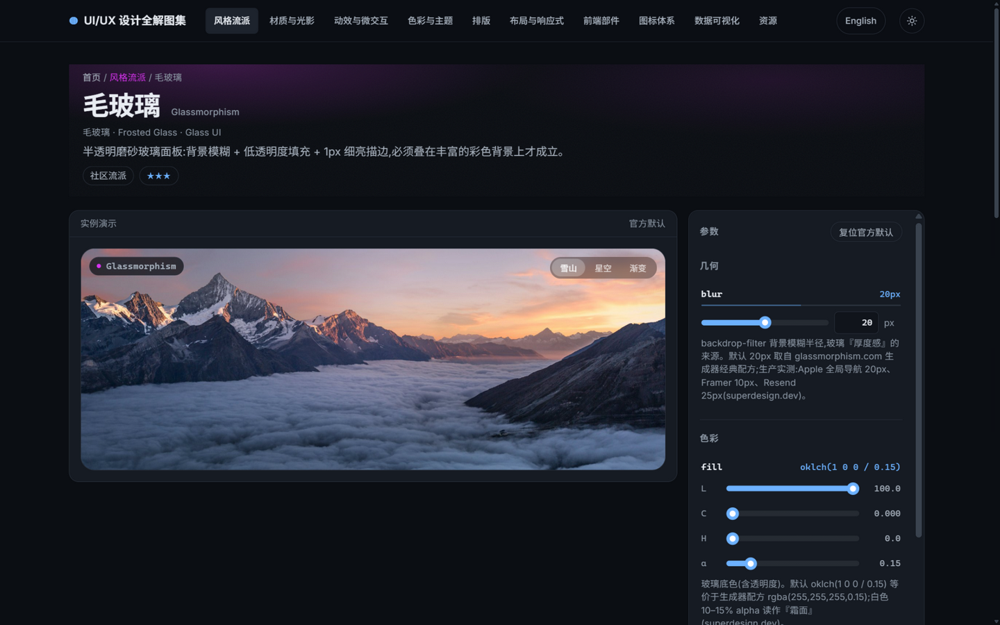
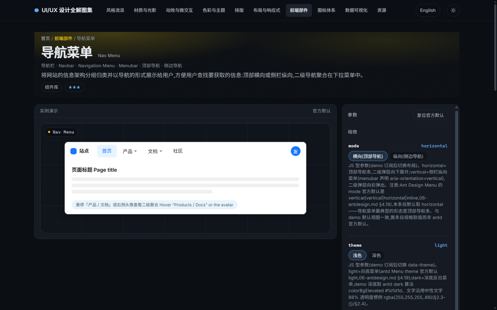
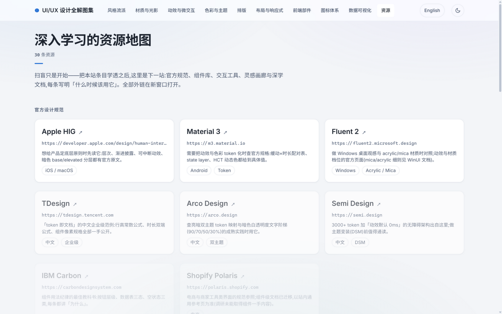

[简体中文](README.md) | English

<div align="center">

# uiux-atlas · UI/UX Design Atlas

**For AI-coding users · Modern UI/UX design explained · Astro+React parameterized playground · Structured replication prompts**

[](https://rethymus.github.io/uiux-atlas/)
[](#-tech-stack)
[](#-what-is-this)
[](#-license)

> The design language and inspiration come from five lines of design research (Apple HIG / TDesign / ByteDance Arco+Semi / gallery trends / reusable code); the full decision record lives in [docs/design-spec.md](docs/design-spec.md).

</div>

> [!IMPORTANT]
> This is a **design learning atlas** — not a component library, and not production-grade component source. Every entry demo is a **teaching implementation**: simplified to explain the mechanism, and not meant to be copied into production as-is.

> [!WARNING]
> Platform-proprietary materials — Fluent Acrylic / Fluent Mica / Liquid Glass / SwiftUI materials, etc. — are **approximated** in the web demos. Values the platform does not publish (or publishes only partially) are honestly labeled "community approximation" inside the entries; see `materials/fluent-acrylic`, `materials/liquid-glass`, `materials/swiftui-materials` and the corresponding entries.

> [!CAUTION]
> Official values and browser-support statements in the entries were verified at research time on **2026-11-20/21**. Specs and platform docs drift; always re-check the official docs. Every entry's `schema.json` carries first-hand source URLs (the `sources` field).

> [!NOTE]
> Fully static site: no backend, no accounts, no tracking, no data upload. All interactions (parameter tuning, prompt generation, theme switching) run locally in your browser.

## 📖 What is this

uiux-atlas breaks modern frontend UI/UX knowledge into **194 entries × 10 categories** (styles 18 / materials 16 / motion 33 / color 20 / type 17 / layout 16 / components 31 / icons 12 / dataviz 12 / principles 19; parameterization star distribution 3★ 116 / 2★ 77 / 1★ 1; the 194 total is this session's `node scripts/verify-entries.mjs` result (`{"expected":194,"found":194,"problems":0}`), per-category counts from that script's expected inventory, star distribution scanned entry by entry from each `schema.json`). Every entry is built from four elements: **① live example** (a React-island demo that updates as you tweak), **② code breakdown** (bilingual four-part walkthrough: DOM structure / styles & params / motion & interaction / parameter sensitivity), **③ real-time parameter panel** (controls auto-generated from the entry's `schema.json`), and **④ one-click replication prompt** (the current parameter snapshot condensed into a structured prompt — the "Copy replication prompt" button hands it to any AI agent).

The entry data model is a three-file trio under `src/content/entries/{category}/{slug}/`:

| File | Content |
|---|---|
| `schema.json` | Metadata + parameter contract: name (incl. Chinese `nameZh`), category, source system, parameterization star (1–3★), params (6 types), use/avoid scenarios, a11y, browser support, fallback, `sources` (first-hand URLs), `promptTemplate` |
| `zh.mdx` / `en.mdx` | Bilingual body, four-part h2 breakdown, rendered into the entry page |
| `demo/Demo.tsx` | Interactive demo (React island), sharing one store with the parameter panel |

## 📸 Screenshots

**All nine screenshots are real running captures, not mockups**: all taken on 2026-11-23 against the pre-release final state (the full set was 186 entries then, across 10 categories, with the header search button and the back affordance), from a preview of the local `pnpm run build` output (under the deploy subpath `/uiux-atlas/`). The "Online URL" column points at the matching page of the live site — open it to compare directly; to reproduce locally, run `pnpm dev` and open `http://localhost:4321/uiux-atlas/…` — replace `https://rethymus.github.io` with `http://localhost:4321` in any online URL and you get the same page. Note: the formula & algorithm batch (+8 entries, 186 → 194 on 2026-11-24) landed after the captures; the nine page shapes are unaffected, only per-category counts follow the current build; the screenshots have not been re-captured.

| Theme | Page | Screenshot | Online URL |
|---|---|---|---|
| Dark | Home (live hero demo + bento) |  | `https://rethymus.github.io/uiux-atlas/` |
| Light | Home |  | `https://rethymus.github.io/uiux-atlas/` (switch to light) |
| Dark | Entry styles/glassmorphism (demo + param panel) |  | `https://rethymus.github.io/uiux-atlas/styles/glassmorphism/` |
| Light | Entry styles/glassmorphism |  | `https://rethymus.github.io/uiux-atlas/styles/glassmorphism/` (switch to light) |
| Dark | Entry components/nav-menu (top nav + avatar hover menu) |  | `https://rethymus.github.io/uiux-atlas/components/nav-menu/` |
| Light | Resources (30 links × five groups) |  | `https://rethymus.github.io/uiux-atlas/resources/` |
| Dark | Trend-tracking page (rising/cooling + caveat notes) |  | `https://rethymus.github.io/uiux-atlas/trends/` |
| Dark | Entry dataviz/dataviz-colorblind-safe (four colorblind-simulation views) |  | `https://rethymus.github.io/uiux-atlas/dataviz/dataviz-colorblind-safe/` |
| Dark | Entry, mobile 360px (demo first, panel follows) |  | `https://rethymus.github.io/uiux-atlas/styles/glassmorphism/` (360px viewport) |

## ✨ Features

| Feature | Status | Notes |
|---|---|---|
| 194 bilingual entries across ten categories | ✅ | 194 entries × zh/en = 388 MDX bodies; bilingual three-layer routing (zh unprefixed, en under `/en/`) plus the resources and trends pages — `astro build` emits 415 pages (measured this session at 37.98s; the verify-dist gate covers 414 of them, the other being the 404 error page). **Entry/MDX scale: this row + the `verify-entries` gate measurement is the authoritative figure** (measured this session: `{"expected":194,"found":194,"problems":0}`); the "43 entries × 86 MDX" in `docs/design-spec.md`'s header and appendix is an MVP-era leftover never backfilled by later version bumps and is not the scale figure (see the Design-system section note) |
| Formula & algorithm domain (8 entries, all with zero-dependency JS implementations) | ✅ | the full set's 186 → 194 growth of +8: `type/modular-scale-math` (modular scale math) / `type/rhythm-formula` (line-height rhythm formula) / `color/oklch-conversion` (OKLCH conversion formula) / `principles/contrast-ratio-formula` (contrast-ratio formula) / `layout/grid-math` (grid math) / `dataviz/scale-functions` (scale functions) / `motion/spring-integrator` (spring integrator) / `motion/easing-math` (easing-function math); each entry = formula breakdown + tunable params + a **zero-dependency JS reference implementation** (native inline demo code, no third-party library); per-category landings: type 15 → 17 / color 19 → 20 / layout 15 → 16 / motion 31 → 33 / dataviz 11 → 12 / principles 18 → 19, all folded into the `verify-entries` / `verify-dist` mandatory missing-checks (this session's runs: `{"expected":194,"found":194,"problems":0}` and verify-dist `{"checked":414,"missing":0,"contentFails":0}`) |
| Interaction-laws domain (tenth category `principles`, 15 + 3 + 1 entries) | ✅ | `fitts-law` / `hick-law` / `millers-law` / `jakobs-law` / `peak-end-rule` / `doherty-threshold` (interaction cadence <400ms) / `teslers-law` / `gestalt-proximity` / `gestalt-similarity-closure` / `serial-position` / `von-restorff` / `apg-patterns` (W3C ARIA APG) / `wcag-checklist` / `prefers-contrast` / `keyboard-navigation`; sources are mainly W3C (APG / WCAG 2.2) and Laws of UX, entry by entry in each `schema.json`'s `sources` field; verify-entries re-ran this session, principles 19/19; the second batch's +3 (`aesthetic-usability` / `goal-gradient` / `pareto-principle`, study 12 §14) sit under the "nine-batch full expansion" row, and the formula batch's +1 (`contrast-ratio-formula`) under the "Formula & algorithm domain" row; the category-accent token `--cat-principles` is now defined (see Design-system point 2, the earlier gap note is closed) |
| Full backfill (97 → 142 entries, nine → ten categories) | ✅ | layout +8 (`anchor-positioning` / `subgrid` / `masonry-columns` / `grid-lanes` / `holy-grail` / `auto-fit-minmax` / `position-sticky` / `safe-area`) / typography +6 (`cjk-typography` / `text-wrap-balance` / `measure-line-length` / `wcag-text-spacing` / `font-display-strategy` / `drop-cap-initial`) / color & theming +5 (`p3-wide-gamut` / `semantic-token-layers` / `m3-tone-surfaces` / `color-psychology-ui` / `theme-transition`) / style history +3 (`maximalism` / `classic-brutalism` / `spatial-ui`) / motion +6 (`m3-duration-tokens` / `easing-pairs` / `choreography` / `parallax` / `haptics-web` / `page-transitions`) / dataviz +2 (`dataviz-chart-selection` / `dataviz-color-ordering`) — 45 entries total, closing out the full set together with the interaction-laws domain's 15; research backing `out/design-study/11-modern-completion.md` ("现代新概念补研(全量补全)", 2026-11-22, first-hand BCD data; §1 anchor positioning / §2 text-wrap balance / §4 masonry & Grid Lanes / §5–§7 spatial-ui · classic brutalism · maximalism / §8 theme-switch transitions), remaining entries traced entry by entry via each `schema.json` `sources`; verify-entries re-ran this session `{"expected":194,"found":194,"problems":0}` (full-set figure, covering this batch and the later batches), build measured this session at 415 pages |
| Apple material layer (parameterized: unified params for neutral gray scale / sampled blur / tint / inner highlight / hairline border / focus ring) | ✅ | spec v2.6 §2.8: three-tier material tokens (`--mat-thin/regular/thick-*`: blur 12/20/28px × tint α × inner highlight × hairline border × shadow, both themes) + the Apple neutral gray scale `--ios-*` (six systemGray tiers etc., official values traced to `out/design-study/09-apple-materials.md` §2) + the `.material` utility with five-surface semantic integration (site header / filter bar / param panel / demo panel / prompt export box) + the press pair `--press-scale: 0.96` + the unified focus ring `--focus-ring-*` (2px accent + offset 1px, verbatim apple.com production-CSS spec); lands in `src/styles/global.css` with `@supports`-gated fallbacks; unpublished magnitudes labeled honestly; `check:contrast` re-ran this session, 12/12 |
| Micro-interaction domain (press feedback pair / slot spring / overlay entrance / exponential-decay shake / toast spring / damping craft / smoothness craft / scroll overflow) | ✅ | motion category 11 → 19: eight new craft/behavior entries — `press-feedback` (press feedback pair) / `slot-spring` (slot spring) / `overlay-entrance` (overlay entrance) / `shake-decay` (error shake, exponential decay) / `toast-spring` (toast spring entrance) / `damping-craft` (damping) / `smooth-craft` (smoothness) / `scroll-overflow` (scroll overflow) — each with a param contract and a `prefers-reduced-motion` fallback; the same batch grows styles 7 → 15 (eight style-history entries) and upgrades two existing entries (toast spring params, liquid-glass refraction/morph params — see roadmap V3); verify-entries re-ran this session 194/194 (full-set figure), build measured this session at 415 pages |
| Nine-batch full expansion (142 → 185 entries, +43) | ✅ | nine batches of new entries, folded into the same `verify-entries` / `verify-dist` mandatory missing-checks as the existing full set: layout second batch b16 +6 (`split-view` / `aspect-ratio` / `responsive-images` / `logical-properties` / `writing-modes` / `custom-scrollbar`) / typography second batch b17 +6 (`tabular-numbers` / `baseline-grid` / `font-pairing` / `small-caps-features` / `vertical-rhythm` / `display-typography`) / color second batch b18 +5 (`brand-color-system` / `dark-mode-patterns` / `status-color-system` / `color-functions` / `multi-theme-tokens`) / motion second batch b19 +6 (`flip-technique` / `scroll-snap` / `magnetic-hover` / `kinetic-typography` / `progress-motion` / `handoff-curves`) / components second batch +6 (`cascader` / `collapse-panel` / `rate-score` / `stepper` / `timeline` / `upload-states`, components 24 → 30) / materials second batch b21 +4 (`contact-shadows` / `specular-highlight` / `dimming-layer` / `depth-of-field`, materials 12 → 16) / icons second batch b22 +4 (`icon-font-vs-svg` / `icon-button` / `favicon-stack` / `icon-system-design`, icons 8 → 12) / dataviz expansion b23 +3 (`small-multiples` / `chart-animation` / `chart-accessibility`, dataviz 8 → 11) / principles second batch b24 +3 (`aesthetic-usability` / `goal-gradient` / `pareto-principle`, principles 15 → 18) — 43 entries total; research backing `out/design-study/12-expansion.md` ("全量扩编所需新概念补研" / new-concepts study for the full expansion, 2026-11-22, first-hand captures from MDN / web.dev / W3C (WAI-APG) / Laws of UX / Ant Design etc.), all 43 `schema.json` `sources` are http(s) (checked entry by entry by verify-entries; this session's scan found 43/43 with sources); verify-entries re-ran this session `{"expected":194,"found":194,"problems":0}`, build measured this session at 415 pages (the 194 full set = the nine batches' 43 + command-palette 1, see the command-palette row below, + the formula & algorithm domain's 8, see the formula-domain row above) |
| Ctrl+K command palette & site search | ✅ | a global command overlay invoked by the header search button or Ctrl+K / Cmd+K: bilingual fuzzy search over all 194 entries (subsequence matching with consecutive-hit and word-start weighting; the `matchMode=prefix` tier is an entry-demo param; the primary localized name + the other locale's name + all `aliases` all participate), ↑↓/Home/End to choose, Enter jumps to the entry page, Esc closes. `src/components/CommandPalette.tsx` (zero third-party deps): APG "Combobox with Listbox Popup" semantics (`input[role=combobox]` + `aria-activedescendant` + `ul[role=listbox] > li[role=option]`, wrapped in `role=dialog` + `aria-modal`), focus trap, body scroll lock with scrollbar-width compensation while open, focus returned to the invoker on close, Mac shows ⌘K / others Ctrl K (detected after mount to avoid hydration mismatch); data = `src/lib/paletteData.ts` injecting name/nameZh/aliases/category/star for all entries at build time via `getCollection("entries")`, mounted site-wide as a single island by `Base.astro` (`client:load`). **Dogfooded**: the panel itself is the 31st components entry `components/command-palette` (3★; params `matchMode` / `maxResults` / `hotkeyDisplay`; sources are W3C ARIA APG links; the entry's demo reuses the same implementation via `PalettePanel`) — the 185 → 186 entry-count change comes from it, verify-entries re-ran this session with components 31/31; `dist/llms.txt` measured this session at 230 lines and lists the entry (components section labeled (31)); verify-dist checks the header search button marker `data-palette-open` on every page (this session's run: 414 pages, 0 missing) |
| Back affordance & prev/next pager | ✅ | the entry page's compact header carries an explicit "← {category}" back link (`src/components/EntryDetail.astro`: category semantic color `--cat`, hit area ≥44px); `src/layouts/Base.astro`'s site-wide script takes over `[data-back]` clicks — when the referrer is same-origin and `history.length > 1` it calls `history.back()` (preserving the list page's scroll position and filter state); direct links / off-site / new tabs fall through to the native href; `history.scrollRestoration = "auto"` is declared explicitly to prevent regressions (an MPA without ClientRouter, where fully static list pages make auto correct). The entry page footer carries a same-category prev/next pager (`EntryDetail.astro`, computed in `getStaticPaths` in the category's list order; first/last entries render the respective half-cell disabled; `aria-label` = "prev/next: {display name}"). Measured this session on `dist/styles/glassmorphism/index.html`: back-link `href="/styles/"`, `aria-label="上一条:极繁主义"` and `aria-label="下一条:孟菲斯设计"` all present |
| Palette presets | ✅ | color params (including per-layer shadow colors) render a row of preset swatches at the bottom of the control (`src/components/ParamPanel.tsx` `colorPresets` + `SwatchRow`): a two-tier source — **schema-declared `presets` win on semantics** (`src/lib/schema.ts` admits the field into the zod contract; this session's scan found 4 entries declaring presets: `styles/glassmorphism` frost-α ladder and dark glass / `materials/dimming-layer` 25% scrim ladder / `layout/custom-scrollbar` scrollbar-track scrim / `styles/spatial-ui` shadow steps per spec §2.5); **when undeclared, presets are derived programmatically from the param's default** (site-side derivation, honestly labeled: default lightness L∈0.05–0.95 → L ladder −0.15/default/+0.10; semi-transparent (α∈(0,1)) → α ladder ×0.5/default/×2 capped at 1; pure black/white honestly yield nothing; only L/α move — no new hues introduced; output matches the param's format). Swatch interaction reuses `.enum-seg`'s `aria-pressed` selected semantics, transparent colors sit on a checkerboard well, `aria-label`/`title` = the preset color string itself (screen-reader readable); styles land in `src/styles/global.css` (`.swatch-row`, verified in this session's build CSS); decision record: design-spec v2.6 §3 ① "preset swatches" |
| Code copy button & OG meta | ✅ | **① body code-block copy**: `src/layouts/Base.astro` client enhancement injects a small "复制代码 / Copy code" button at the top-right of every Shiki code block (`.prose pre.astro-code`): navigator.clipboard first, `execCommand` fallback on insecure contexts (same source as PromptExport.writeClipboard), success receipt "已复制 ✓ / Copied ✓" + a micro pulse, one site-wide `role="status"` live region for screen-reader announcement; injection is idempotent, and without JS the code stays readable and manually selectable. Build-output check: the copy script ships site-wide via `dist/_astro/Base.astro_*_lang.*.js` and `.code-copy` styles are in the built CSS. **② OG / Twitter meta**: the same file injects site-wide canonical + bilingual hreflang cross-references (zh-CN / en / x-default=zh) + og:site_name / type / title / description / url / image / locale (:alternate) + a twitter:card summary_large_image set; entry pages use og:type=article; og:image defaults to the site-level share image `/photos/glass-alps.jpg` (an existing public asset). Measured this session: og:* / twitter:* / canonical / hreflang all present in `dist/styles/glassmorphism/index.html`. Absolute URLs derive from `astro.config.mjs`'s `site` + `base`, now the real domain: the same file's canonical is `https://rethymus.github.io/uiux-atlas/styles/glassmorphism/` and og:image is `https://rethymus.github.io/uiux-atlas/photos/glass-alps.jpg` |
| Parameter panel | ✅ | Controls auto-generated from the entry's `schema.json` params contract: sliders / OKLCH 4-axis / bézier curve editor / segmented buttons / per-layer shadow; with "reset to official defaults" |
| One-click replication prompt | ✅ | `store.exportSnapshot()` + `buildPrompt` condense the snapshot into a structured prompt; the "Copy replication prompt" button copies it to any AI agent. Live-fire test: HTML produced by a replication agent from the prompt alone hits **7/7** key parameters (threshold ≥5/7, `scripts/verify-prompt-test.mjs`; re-ran this session, 7/7) |
| AI-agent channel (llms.txt + per-entry .md) | ✅ | `src/pages/llms.txt.ts` static endpoint: site positioning + ten categories + the full entry list (name / nameZh / URL / en page / md link); every entry also ships a plain-text `/{category}/{slug}/index.md` (`src/pages/[category]/[slug]/index.md.ts`). Measured this session: `dist/llms.txt` emitted (230 lines, incl. a `## principles 交互法则 / Principles (19)` section and a `## components 前端部件 / Components (31)` section), `dist/styles/glassmorphism/index.md` present; every in-site address in the list carries the deploy subpath `/uiux-atlas/` (e.g. `/uiux-atlas/styles/glassmorphism/` with its md link `/uiux-atlas/styles/glassmorphism/index.md`) |
| MCP server (four tools) | ✅ | `mcp/server.mjs`: a zero-dependency stdio JSON-RPC server (per MCP spec 2025-03-26: initialize handshake with version negotiation, tools/list / tools/call, JSON-RPC batching), read-only over each entry's `schema.json`; four tools — `search_entries` / `get_entry` / `build_prompt` / `list_categories` (build_prompt serializes params with the same code as the site's "Copy replication prompt"); coding agents (Claude/Cursor etc.) connect via `node mcp/server.mjs`; the wiring guide (Claude Desktop / Cursor) is at [docs/mcp-setup.md](docs/mcp-setup.md). Gate `test:mcp`: twelve assertions over the initialize → tools/list → tools/call sequence (incl. the subpath-adaptation addition "get_entry entry URLs carry the deploy subpath"); measured this session: 12/12 pass (negotiated protocol 2025-03-26) |
| shadcn registry (31 items) | ✅ | the 31 frontend-component demos published inline as shadcn registry items + an index (`public/registry/`, 31 items + index.json = 32 files; shipped as static `dist/registry/` after `pnpm run build`, directly pullable by the shadcn CLI / compatible clients); the `verify:registry` gate scope is now synced to all components entries (24 base + second batch 6 + this round's command-palette = 31), measured this session `{"expected":31,"items":31,"problems":0}` (command-palette.json included); usage under "Deployment → Registry usage (agent consumption)" |
| Open in v0 | ✅ | the entry-page "Open in v0" secondary button (`src/components/PromptExport.tsx`): `encodeURIComponent`s the current replication prompt into `https://v0.dev/chat?q=…` and opens it in a new tab, prefilled. URL-scheme provenance: the official URL-parameter docs are gone (nothing in today's v0.app/docs or vercel.com/docs/v0), so the scheme was verified behaviorally on 2026-11-21 via curl (the 307 redirect chain `v0.dev/chat → v0.app` preserves `q` end to end; the final page's RSC payload contains the prefilled prompt) — an **officially unendorsed, behavior-verified** scheme; if it breaks, fall back to "copy the prompt + open the v0 home page" (evidence chain in that file's header comment) |
| Parameter-snapshot share link | ✅ | `src/lib/shareLink.ts` serializes the current snapshot as `#s=name=value&…` appended to the address; the "Share parameter link" button copies the full link (`src/components/PromptExport.tsx`); opening the link, `DemoStage` parses and restores it on mount — only params present in the schema are restored, invalid values filtered, numbers clamped to min/max |
| Embedded contrast checker | ✅ | `src/components/ContrastChecker.tsx` renders as an extra panel inside the demo stage of two color entries (`color/oklch-workflow` / `color/wcag-contrast`, see `src/components/DemoStage.tsx`): WCAG contrast ratio computed live for foreground/background (`src/lib/color.ts` `contrastRatio`, same implementation as the wcag-contrast entry) |
| @property type constraints | ✅ | `src/styles/global.css` declares `@property` types for the dogfooded styles/glassmorphism parameter variables (`--glass-blur` / `--glass-fill` / `--glass-border` / `--glass-radius`) — typed fallbacks even when a variable is unset; unsupported browsers skip the whole rule; the count-up entry's `--num` does the same |
| Dark & light themes | ✅ | Dark by default, light as a full first-class citizen (same semantic layer, per-theme values); `localStorage("atlas-theme")` persistence + head anti-flash script + dual `theme-color` meta; the two theme token sets pass the contrast gate 12/12 |
| Resources navigator | ✅ | `/resources/` and `/en/resources/`: 30 resources × five groups (official specs / component libraries / interaction & motion tools / inspiration galleries / deep-dive docs), all real URLs, whole-card external links |
| Trend-tracking page | ✅ | `/trends/` and `/en/trends/` (`src/pages/trends.astro` + `src/data/trends.ts`): a point-in-time snapshot of 2023–2026 rising/cooling design trends, distilled entry by entry from `out/research/03-visual-style-trends.md` §2 with per-item provenance and caveat notes (share figures labeled "request share within one AI design tool, not market adoption"); `relatedEntries` in-page links carry a build-time guard — a hardcoded dead link fails the build; measured this session: both pages emitted (`dist/trends/`, `dist/en/trends/`) |
| Subpath deployment adaptation | ✅ | the site is published as a GitHub Pages project page under the subpath `/uiux-atlas/` (`astro.config.mjs`: `site: "https://rethymus.github.io"` + `base: "/uiux-atlas"`): every in-site address is generated through `src/lib/urls.ts`'s `withBase()`, covering page links, static endpoints (llms.txt, per-entry `index.md`, robots.txt, sitemap.xml), footer links, photo paths in 11 demo files, the command palette's runtime fetch (`registry/palette.json`), font preload addresses, the 404 page, and MDX cross-links; the gates are locked in step — `verify-dist` gained a "every in-site address in the output must carry the deploy subpath" assertion (this session's run: 16,246 addresses with the `/uiux-atlas/` prefix, 0 values slipping through), `check-perf` gained a "photo addresses carry the deploy subpath" assertion, and `test:mcp` gained a "`get_entry` entry URLs carry the deploy subpath" assertion; `mcp/server.mjs` and the check scripts read `base` directly from `astro.config.mjs`, so switching domain/subpath means changing that one spot |
| Local one-click publishing to gh-pages (no GitHub Actions required) | ✅ | `pnpm run deploy` (`scripts/deploy-gh-pages.mjs`, zero-dependency: node built-ins + git): build → one orphan commit in a temporary worktree → force-push to the remote `gh-pages` branch → clean up; ships `.nojekyll`; refuses to publish with uncommitted changes in the working tree, `--dry-run` does not push, `--skip-build` publishes a ready `dist/`. Publishing needs no host-side CI — one local command; the live site is `https://rethymus.github.io/uiux-atlas/`, steps under "Deployment" |
| Platform-proprietary materials | ⚠️ | Web approximations: `liquid-glass` (refraction via SVG `feDisplacementMap`), `fluent-acrylic` (blur radius unpublished; 24px is a common community approximation), `swiftui-materials` (six opacity/blur tiers are a community approximation table — official values unpublished) — annotated in place inside each entry |
| SwiftUI API surface | ⚠️ | `swiftui-spring`, `swiftui-materials` etc. are **comparison demos**: the web side conveys parameter semantics and trends; on-device rendering is the source of truth |
| Code breakdown | ⚠️ | MVP form = highlighted code + per-section commentary (bilingual MDX, four h2 parts; `BreakdownTabs.tsx` groups content by h2 into tabs); the full four-part teaching narrative (breakdown↔content linkage) is not done yet — see the unchecked roadmap item |
| Prompt validation | ⚠️ | **Local proxy metric**: 7 regex checks + threshold ≥5/7, an internal regression baseline — not a cross-agent public benchmark (no external standard for prompt quality; the blueprint records this as engineering inference) |

### Deliberately not built (❌)

- **Backend / accounts / cloud sync**: fully static, zero server — a learning atlas needs no account system or cloud state; adding one would break the "fully static, no tracking" promise (see the NOTE at the top).
- **Live design-trend scraping**: content is a 2026-11-20/21 research snapshot; no live trend scraping. The trend-tracking page (✅ row above) ships as a point-in-time snapshot and **the refresh scaffold is in place** (`scripts/refresh-trends.mjs`: prints the quarterly-refresh handbook and `exit 1`s when `lastReviewed` is >90 days old; re-fetching the data still requires a human to run the research flow — recipe: re-run the `out/research/03` web-research flow and replace the numbers in `src/data/trends.ts`; caveat wording and source text follow that study — see "quarterly refresh automation" in the roadmap).

### Invalid-input contract

Entry data is not lenient input: every `schema.json` passes the zod contract in `src/lib/schema.ts` (wired into Astro content collections via `src/content.config.ts`) — **any non-conforming field fails `astro build`; nothing is silently ignored**. On top of that, `scripts/verify-entries.mjs` runs an independent machine re-check (194-entry expected inventory, non-empty bilingual fields, `sources` must be http(s) URLs, per-type params shape, `nameZh` coverage); any problem → `exit 1`.

## 🧰 Tech stack

| Layer | Choice | Rationale (see design-spec) |
|---|---|---|
| Framework | Astro 5 (`^5.7`, measured 5.18.2) | Content site, mostly static; demos/panel/filters hydrate as needed as islands; built-in bilingual i18n routing (zh unprefixed, en `/en/`); content collections validate entry data. Choice follows the blueprint's "Plan C: Astro + token pipeline" |
| UI runtime | React 19 islands | Demo components, param panel, filter bar, tabs, hero mini-demo are React islands; same runtime generation as motion v12 |
| Motion | `motion` ^12 | JS-typed params (spring family) driven directly by the same store; JS springs use the official default bounce 0.25 / damping 10 (spec §2.6); static effects are always zero-JS pure CSS (spec §6c porting rules) |
| Data validation | `zod` ^3.24 | Entry schema contract (per-type checks for 6 param types); invalid input → build failure (contract above) |
| Styling | Native CSS semantic tokens (single file `src/styles/global.css`) | Both themes share the semantic layer, values per theme (spec §2.1); no Tailwind, no CSS-in-JS — design tokens are the single source of truth (spec §2 full tables) |
| Fonts | Self-hosted @fontsource: Inter Variable + Noto Sans SC (400/500/700) | No SF Pro (licensing and cross-platform consistency, spec §2.2); JetBrains Mono is **not bundled** — it is only the first choice of `--font-mono`, falling back to system monospace |

## 🚀 Quick start

Prerequisites: Node ≥ 18.17 (Astro 5 baseline), pnpm ≥ 7.1 (or npm ≥ 9.6.5) — these numbers come from the **astro package's engines declaration** (this repo pins `astro@5.18.2`, whose engines are `node 18.20.8 || ^20.3.0 || >=22.0.0`, `npm >=9.6.5`, `pnpm >=7.1.0`; the repo's own package.json sets no engines field).

```bash
# Run directly from the repo root (i.e. inside your clone of this repo) — no -C prefix needed
pnpm install                        # install dependencies
```

| Command | Purpose | Gate (`exit 1` on failure) |
|---|---|---|
| `pnpm dev` | Dev server (`http://localhost:4321/uiux-atlas/`, including the base subpath) | — |
| `pnpm run build` | Static build of the whole site into `dist/` | Content-collection zod validation; non-conforming entries fail the build; measured this session: 415 pages (37.98s) |
| `pnpm run check` (`astro check`) | Type check | Passes only with 0 errors / 0 warnings; measured this session: 256 files, 0/0 + 4 hints (the pre-existing `document.execCommand` deprecation ×2 — PromptExport and the code-copy button share the same clipboard fallback in `Base.astro`, covered by the fallback; one unused local each in the `motion/parallax` and `icons/icon-button` demos, demo-only code — all known acceptable; `astro check` exits 0) |
| `pnpm run check:contrast` | WCAG contrast gate for both themes (`scripts/check-theme-contrast.mjs`) | Text ≥4.5:1, UI components ≥3:1, 12 pairs total; any miss → `exit 1`; measured 12/12 pass |
| `pnpm run check:perf` (build first) | dist key-page performance gate (`scripts/check-perf.mjs`; zero-dep, reads build output only) | Six key pages (zh/en × home / category styles / entry styles/glassmorphism): HTML byte budget = baseline measured ×1.1 headroom (e.g. zh home baseline 36,655B → budget 40,321B), astro-island count cap = baseline measured page-by-page (home/category 2, entry 4 — new islands must be deliberate and raise the cap), all photo `` carry `loading="lazy"`, photo addresses carry the deploy subpath, head carries the `@font-face` bundled CSS and the LCP font preload; prints per-item detail, any failure → `exit 1`; measured this session: 6 pages / 36 assertions / 0 failures |
| `pnpm run check:a11y` (build first) | dist all-HTML static accessibility gate (`scripts/check-a11y-static.mjs`; zero-dep, reads build output only) | Four assertions: 100% `alt` coverage on `` (decorative `alt=""` counts), icon buttons (`<button>` with no visible text) must be named (aria-label/aria-labelledby/title), exactly one `h1` per page, `html lang` present and non-empty; prints per-page violation detail, any violation → `exit 1`; measured this session across 415 pages: 2/2 alt, 1040/1040 icon buttons named, 415/415 exactly one h1, 415/415 lang present, 0 violations |
| `node scripts/verify-entries.mjs` | Machine check of entry integrity | 194-entry expected inventory + structure/bilingual/source URLs/params shape/`nameZh`; any problem → `exit 1`; measured `{"expected":194,"found":194,"problems":0}` |
| `node scripts/verify-dist.mjs` | Build-output check (run build first) | All 414 pages of the bilingual three-layer routing (10 categories ×2 + 194 entries ×2) plus home/resources/trends emitted and carrying key content markers (incl. the verbatim "Copy replication prompt" button copy, the header search button `data-palette-open` on home/category pages, and in-site addresses carrying the deploy subpath); missing/contentFails > 0 → `exit 1`; measured `{"checked":414,"missing":0,"contentFails":0}` |
| `node scripts/verify-prompt-test.mjs` | Prompt replication live-fire test | Checks whether `out/prompt-test/glassmorphism.html` (a page produced by a replication agent from the exported prompt alone) hits 7 key parameters; threshold ≥5/7, below → `exit 1`; measured 7/7 |
| `pnpm run generate:registry` (generate) → `pnpm run verify:registry` (gate) | shadcn registry artifacts: the 31 frontend-component demos inlined as registry item JSON + index (JSON array) into `public/registry/` (published with dist at build time; usage under "Deployment → Registry usage (agent consumption)") | The 31 item JSONs parse, `name`/`type`/`files[].path`/`content` non-empty, no leftover `@/` imports, index count matches item count; any miss → `exit 1`; scope synced to all components entries (`EXPECTED_COUNT = 31`), measured this session `{"expected":31,"items":31,"problems":0}` |
| `node scripts/test-mcp-server.mjs` (or `pnpm run test:mcp`) | MCP server (stdio JSON-RPC) smoke test: spawns `mcp/server.mjs` and drives an initialize → tools/list → tools/call sequence | Twelve assertions: initialize response carries capabilities and serverInfo, the protocol version echoes 2025-03-26, tools/list lists all four tools (search_entries / get_entry / build_prompt / list_categories), get_entry(glassmorphism) no error and contains 「毛玻璃」, entry URLs carry the deploy subpath, build_prompt (params override blur=30) contains blur 30px; any failure prints details and `exit 1`; measured this session: 12/12 pass (wiring guide at [docs/mcp-setup.md](docs/mcp-setup.md)) |

There is also the one-off script `scripts/add-name-zh.mjs` (injects Chinese `nameZh` into the first-batch 43 schemas; idempotent; cross-checks mapping keys against disk entries, any mismatch → `exit 1`; later entries carry `nameZh` written with the entry itself, with 194/194 coverage enforced by verify-entries) — not needed in day-to-day development, listed for completeness only.

## 🎨 Design system

The site dogfoods itself: the home hero reuses the `styles/glassmorphism` entry's demo and store. The design language in five points:

1. **Dual-theme stage**: dark by default, light a full first-class citizen; one semantic layer, per-theme values; neither theme allows pure black/pure white backgrounds (dark `--bg #0b0e13` carries a blue hue, light `--bg #f3f5f8` same-hue orientation).
2. **Hierarchy on three axes, no ornament**: size/weight/color only; a single `--accent` blue carries all interactive semantics; the ten category accents appear only where category semantics live (`--cat-principles` is now defined: dark = Apple systemTeal `#40c8e0` (min 7.93:1 against bg/bg-elev/surface/surface-2), light = same hue deepened `#0d7086` (min 4.90:1, AA); the header category band / entry gradient band / bento accent bars follow; computed 2026-11-24).
3. **Progressive disclosure**: explanations, specs and sources collapse into Tabs/Accordion — collapsed by default, one step to expand.
4. **Density is a workstation virtue**: 12–13px mono values + tabular-nums; main blocks of any page reachable within ≤1.5 screens of scrolling.
5. **Purposeful, interruptible, degradable motion**: all 19 embellishments register their purpose and their `prefers-reduced-motion` fallback; motion without a fallback plan does not merge.

Contrast is computed, not guessed: dark four-level text vs bg = 16.45 / 8.90 / 6.43 / 4.18:1, light = 14.29 / 7.00 / 4.94 / 3.17:1 (the fourth tier is the disabled/placeholder tier, AA-exempt); guarded continuously by the `check:contrast` gate (12/12).

**Full text: [docs/design-spec.md](docs/design-spec.md) (v2.6.1)** — the single source of truth, **scoped to design decisions**: full token tables (color / type scale / spacing / radius / shadow / motion) plus the unified material-layer parameter table (§2.8, new in v2.6: three material tiers × both themes + neutral gray scale + focus ring; v2.6.1 adds the `--cat-principles` tenth-category accent and layout-polish revisions), **five page blueprints** (§4: home / list page / entry page / resources navigator / trend-tracking page — the fifth backfilled in v2.4), component specs, the 19-embellishment list, trend adopt/reject rulings and the porting ledger, responsive matrix, and accessibility red lines. **Entry scale is outside that SSOT scope**; the authoritative figure is this README's **194 entries × 388 MDX bodies** (enforced by the `verify-entries` gate). The "43 entries × 86 MDX" in design-spec's header and appendix verification record, plus §4.1's "six-category bento", are MVP-era (v1.0–v2.2) leftovers never backfilled by later version bumps (the round5 report asked for a version bump to fix this) — for entry scale, this README prevails.

## 📦 Deployment

Pure static output — `dist/` is everything; no adapter, no server requirements. Cloudflare Pages or any static host works. One command:

```bash
pnpm run build        # emits dist/ (measured this session: 415 pages)
```

Cloudflare Pages reference: build command `pnpm run build` (from the repo root), output directory `dist`.

### Local one-click publishing to GitHub Pages (gh-pages)

The live site is the GitHub Pages project page: `https://rethymus.github.io/uiux-atlas/` (the `gh-pages` branch of `github.com/Rethymus/uiux-atlas`). Publishing does not depend on host-side CI — one local command:

```bash
pnpm run deploy                 # build → gh-pages orphan commit force-push (full flow in scripts/deploy-gh-pages.mjs)
pnpm run deploy -- --dry-run    # walk the flow without pushing, to preview what would be published
pnpm run deploy -- --skip-build # publish a ready dist/ without rebuilding
```

Script behavior (`scripts/deploy-gh-pages.mjs`, zero-dependency: node built-ins + git): build → one orphan commit in a temporary worktree (incl. `.nojekyll`) → force-push to the remote `gh-pages` branch → clean up the worktree. Two guards: it refuses to publish while the working tree has uncommitted changes (commit first, then publish); before pushing it checks that the in-site address prefix in `dist/` matches `astro.config.mjs`'s `base`, preventing a stale pre-base-change output from being published (the hint tells you to drop `--skip-build` and re-run).

### Registry usage (agent consumption)

> MCP server wiring (Claude Desktop / Cursor): config snippets, the four-tool table and a 3-minute check — **[docs/mcp-setup.md](docs/mcp-setup.md)**.

The 31 frontend-component demos are also published as shadcn registry artifacts; after `pnpm run build` they ship with `dist/registry/` as static files, directly pullable by the shadcn CLI and compatible clients:

- **Index**: `public/registry/index.json` — a JSON array of lightweight entries (`name`/`type`/`title`/`description`/`files`/`meta`, no content); at build time it lands at `dist/registry/index.json`.
- **Per item**: `public/registry/{slug}.json` (e.g. `button.json`, 31 files, `type=registry:component`) — `files[].path` keeps the source-site path `src/content/entries/components/{slug}/demo/Demo.tsx` for provenance, the full Demo.tsx is inlined in `files[].content`, `meta` passes through `nameZh`/`star`/`subgroup`, and `dependencies` stays empty (declare react on the consumer side per your own versions).
- **Pulling**: `npx shadcn@latest add https://<host>/registry/button.json`, or GET the URL yourself and parse `files[].content`.
- **Honest labeling**: every item is a **teaching demo, not a production component** — the three site-internal modules each demo originally imports (`@/lib/store` param store, `@/lib/types` types, `@/components/DemoStage` demo stage) are unavailable to consumers; the generator rewrote those three `@/` imports in place into "[registry rewrite]" comments stating the replacement approach (local controlled state + your own stage container). The matching references in the file body must be replaced per those comments before the file compiles.

Regenerate and gate: `pnpm run generate:registry` → `pnpm run verify:registry` (see the command table above).

> Note: the registry scope is now synced to all 31 components entries following the command-palette entry's landing (`scripts/verify-registry.mjs` `EXPECTED_COUNT = 31`); this session's run gives `{"expected":31,"items":31,"problems":0}` and `public/registry/` ships 32 files with dist — the earlier "24-item assertion exits 1" wording is void.

## 📊 Sources & data provenance

The entries are not written from thin air: nine lines of industry research form the base, five lines of design research shape the design language, and the later batches each got seven dedicated studies (06–12: AntD components / icons / dataviz / Apple materials / micro-interaction code / modern-concepts completion backfill / new-concepts study for the full expansion) — the source mapping is traceable entry by entry. These research and evidence artifacts are **committed to this repo under `out/`** (research in `out/research/`, design studies in `out/design-study/`, the source mapping in `out/mapping.json`, the review reports and blueprints; evidence archive only, not part of the `dist/` build output):

| Source | Content | Caveat |
|---|---|---|
| `out/research/01–09` | Nine research lines: industry reports / official design specs / visual style trends / motion & micro-interactions / layout & typography / color & theming / components & patterns / open-source repos / implementation tech | Research time window 2026-11-20/21; first-hand sources recorded per item |
| `out/design-study/01–05` | Five design-research lines: Apple HIG / TDesign / ByteDance Arco+Semi / galleries & trends / reusable code | The evidence base for every decision in `docs/design-spec.md` |
| `out/design-study/06–12` | Seven domain-specific studies: 06 Ant Design component props first-hand values (24 components entries; second batch partly in 12 §15) / 07 icon systems across five open-source icon sets (8 icons entries; second batch partly in 12 §12) / 08 data-viz color & chart basics (the dataviz domain's first six entries; the 3-entry expansion sits in 12 §13) / 09 Apple materials first-hand measurements (basis of spec v2.6; materials second batch partly in 12 §7–§8) / 10 micro-interaction code, eight entries (V3 motion craft entries; motion second batch partly in 12 §3–§6) / 11 modern-concepts completion backfill (§1 anchor positioning / §2 text-wrap balance / §4 masonry & Grid Lanes / §5–§7 spatial-ui · classic brutalism · maximalism / §8 theme-switch transitions) / 12 new-concepts study for the full expansion (§1 responsive images / §2 logical properties & writing modes / §3 FLIP / §4 Scroll Snap / §5 magnetic interaction / §6 kinetic typography / §7 contact shadows & specular highlight / §8 dimming layers & depth of field / §9 tabular-numbers · baseline grid · font pairing / §10 small caps & vertical rhythm / §11 color functions · status colors · multi-theme tokens / §12 icon systems / §13 data viz / §14 interaction laws / §15 six component specs — the main backing of the nine batches' 43 entries) | 06–08 dated 2026-11-21, 09–12 dated 2026-11-22; first-hand sources recorded per item |
| `out/mapping.json` | Entry-by-entry source mapping (batch / id / researchRef / note, pointing at specific report sections) | This session's scan: 186 records, covering 186 of the 194-entry full set — first batch b0–b5 = 43, components b6 six groups = 24, V1/V3 batches b7 icons 8 / b7 dataviz 6 / b8 motion 8 / b8 styles 8 / b9 principles 15 = 45, full-backfill b10–b14 + b15 dataviz = 30, nine expansion batches b16–b24 = 43, b25-polish (command-palette) = 1, totalling 186; the 8 entries not in the mapping are the formula & algorithm batch (b25-math), whose sources live entry by entry in each `schema.json` `sources` field |
| Rule for official values | Entry parameter defaults only include values **verified against official pages** | Unverified values are not admitted; community approximations must be labeled inside the entry (see the WARNING at the top) |

## ⚠️ Known limitations

Stated as-is, consistent with all dev/review reports: **the reports are all committed to this repo under `out/`** (build / redesign / round2–12, thirteen in total; round7 is the README trust-contract sync, round8 the V3 material-layer/micro-interaction/styles report, round9 the full-backfill (97 → 142) landing report, round10 the nine-batch expansion (142 → 185) + param-panel v2.6 upgrade report, round11 the four-polish report (back & pager / palette presets / Ctrl+K palette / OG·404·copy button), and round12 the dual-audit (perf/a11y) fix + nine-gate lock-in report — none overturns the existing findings). Every item below was re-checked against rounds 4–12 and still holds (the spec SSOT gap flagged by round6 was closed by design-spec v2.4); the formula & algorithm domain's 8 entries (landed 2026-11-24) are the latest batch, closed out together with this README round, and their scale and gate numbers are this README's measured figures:

> [!WARNING]
> - **Platform-proprietary materials are web approximations**: unpublished official values for Liquid Glass / Fluent Acrylic / SwiftUI materials are shown as community approximations, annotated in place; on-device rendering is the source of truth.
> - **Source-URL reachability — the "pending retest" is cleared, no longer an open item**: all 16 source URLs sampled across 6 entries were re-tested live by the round5 report (`out/round5-report.md` §3) via `curl -sL -o /dev/null -w "%{http_code}" --max-time 20` — **16/16 returned 200, unreachable 0**, voiding the earlier "3/16 measured + 13 pending" wording (the round6 report §3 carried that stale wording; where it conflicts with this bullet, the round5 measured record prevails). This repair re-ran the same command over all 16 — still all 200. Remaining caveat: source pages drift with their official docs; quoted values remain research-time (2026-11-20/21) records. The nine expansion batches' 43 entries carry `sources` captured at study-12 time (2026-11-22), while `components/command-palette` (two W3C ARIA APG links + one self-referencing og:url) and the formula & algorithm domain's 8 entries carry `sources` entered at their own authoring time; verify-entries only checks URL shape — **reachability has not been re-tested for any of those three**.
> - **Performance & accessibility: build output locked by static machine gates, on-device acceptance not measured**: two zero-dependency static gates (`scripts/check-perf.mjs` / `scripts/check-a11y-static.mjs` — node built-ins only, read dist output, no network) now machine-check the perf/a11y red lines — `check:perf` six key pages / 36 assertions (HTML byte budget ×1.1 / astro-island caps / photo `loading="lazy"` / photo addresses carry the deploy subpath / head font CSS + LCP preload), `check:a11y` all 415 pages × four assertions (100% img `alt` coverage, named icon buttons, exactly one `h1`, `html lang` present), both re-run green this session (per-item scope in the two Quick-start command-table rows); but Lighthouse/axe scans, the 360px no-horizontal-scroll check, `prefers-reduced-motion` on-device walkthrough, and theme-switch FOUC capture remain unexecuted — the static gates lock output shape and do not replace on-device acceptance (flagged honestly in the design-spec appendix; the round2 report lists them as browser-side gaps).

> [!NOTE]
> - **Shopify Polaris component docs have migrated**: first-hand component content could not be obtained; the resources page states "see Polaris's in-site reference pages" honestly (`src/data/resources.ts`).
> - **View Transitions fully supported only on Chromium**: cross-document view transitions fall back to plain navigation on Firefox etc. — nothing breaks, just no morph.
> - **Trend content is a snapshot**: all entries and trend judgments date from the 2026-11-20/21 research window; no live updates; the refresh scaffold is in place (`scripts/refresh-trends.mjs`), while re-fetching the data still requires a human to run the research flow (see the roadmap).

> [!TIP]
> The site domain and subpath are final: `astro.config.mjs` sets `site: "https://rethymus.github.io"` + `base: "/uiux-atlas"`, and the absolute URLs in canonical / og:url / og:image / hreflang / robots.txt / sitemap.xml all derive from that one spot (measured this session: `dist/styles/glassmorphism/index.html`'s canonical is `https://rethymus.github.io/uiux-atlas/styles/glassmorphism/` and og:image is `https://rethymus.github.io/uiux-atlas/photos/glass-alps.jpg`); switching domain/subpath means changing that one spot and rebuilding.

## 🗺 Roadmap

Per the blueprint (`out/blueprint-v1.md`, four-element evolution table and milestones). Finished items are checked one by one and map onto the commit chain: `11a5d2b` (MVP, 43 entries) → `f18fce6` (mobile filter-bar fix) → `85e4c45`/`83ece35` (V1: the icons + dataviz domains) → `fa10bf9` (V2: agent-consumption channel + trends page) → `3842635` (spec v2.4, closing the round6 SSOT gap) → `7bc672e`/`a170451` (spec v2.5 + light-theme modernization; the latter also committed the 6 updated and 3 new screenshots) → `d5e295a` (V3: Apple material layer per spec v2.6 + styles grown to 15 + motion grown to 19 + upgrades of two existing entries, toast / liquid-glass) → `1c130fe` (full backfill: the new tenth category principles, interaction laws, 15 entries + b10 layout 8 / b11 typography 6 / b12 color 5 / b13 style history 3 / b14 motion 6 / dataviz 2, 97 → 142) → `6fac8e3` (V3 polish & full expansion: micro-interaction / styles / material layer / components & principles second batches and the Ctrl+K command palette closeout, incl. command-palette as entry 186) → `b1d268b` (perf & a11y specialization: dual-audit fixes + `check:perf` / `check:a11y` regression locks + MCP wiring guide + trend-refresh scaffold) → `7397052` (subpath deployment adaptation + evidence archive committed + gh-pages local deploy script) → `baeb34e` (18 visual-review screenshots) → current working tree (the formula & algorithm domain's 8 entries, 186 → 194; this round also finalizes the bilingual READMEs and the MCP wiring guide); unfinished items stay unchecked:

**V1**

- [ ] Upgrade the code breakdown to the full four-part teaching narrative (today: "highlighted code + per-section commentary" MVP form; `BreakdownTabs.tsx` groups content by h2 into tabs)
- [x] Site-wide `llms.txt` index (structured spec for AI agents) — shipped, plus a per-entry `.md` plain-text endpoint (`dist/llms.txt` verified on disk this session, 230 lines, with the ten-category inventory)
- [x] Parameter snapshot sharing (URL hash / share links) — shipped: the `#s=` share link, one-click copy via "Share parameter link", restored on open

**V2**

- [x] MCP server — shipped: `mcp/server.mjs`, a zero-dependency stdio JSON-RPC server (per MCP spec 2025-03-26) with four tools `search_entries` / `get_entry` / `build_prompt` / `list_categories`; gate `test:mcp` measured this session at 4/4 pass (wiring: the Quick-start command table)
- [x] shadcn registry publishing — done: `public/registry/` (index.json + 31 items, generated by `generate:registry` / gated by `verify:registry`, shipped with dist at build time; usage under "Deployment → Registry usage (agent consumption)")
- [x] "Open in v0" — shipped: the entry-page "Open in v0" prefills the replication prompt via `?q=` in a new tab; the URL scheme has no official documentation and was verified behaviorally on 2026-11-21 via curl (evidence chain in the `src/components/PromptExport.tsx` header comment)
- [x] Trend-tracking page — shipped: bilingual `/trends/` (a 2023–2026 rising/cooling point-in-time snapshot distilled from `out/research/03-visual-style-trends.md` §2; data in `src/data/trends.ts`)
- [ ] Registration walkthrough in a real MCP client — only the `test:mcp` stdio smoke assertions exist so far; registration and end-to-end tool calls in a real client (Claude/Cursor etc.) not yet walked through
- [ ] Lighthouse / axe performance and accessibility acceptance on a real device — static machine gates are in place (`check:perf` / `check:a11y` lock the build output, see the Quick-start command table and "Known limitations"); on-device acceptance remains a browser-side gap

**V3**

- [x] Apple material layer — shipped: spec v2.6 §2.8 unified material-layer parameter table (three tiers mat-thin/regular/thick × both themes: sampled blur / tint / inner highlight / hairline border / shadow) + `--ios-*` neutral gray scale + `.material` five-surface integration + the press pair + the unified focus ring, all values traced to `out/design-study/09-apple-materials.md`; `check:contrast` re-ran this session, 12/12
- [x] Micro-interaction domain, 8 entries (motion 11 → 19) — shipped: `press-feedback` / `slot-spring` / `overlay-entrance` / `shake-decay` / `toast-spring` / `damping-craft` / `smooth-craft` / `scroll-overflow`; verify-entries re-ran this session 194/194 (full-set figure)
- [x] Styles grown to 15 (7 → 15) — shipped: eight style-history entries `flat-design` / `skeuomorphism` / `memphis-design` / `swiss-international` / `editorial-magazine` / `frutiger-aero` / `y2k-retro-futurism` / `holographic-chrome`
- [x] Two existing entries upgraded — shipped: `components/toast` gains the stiffness/damping spring param pair (Motion source defaults verified verbatim), `materials/liquid-glass` gains the refraction-displacement and morph (pod / expanded panel) params; toast is one of the registry artifacts (re-run passed under the then-24-item scope; the scope is now the 31-item full set, `verify:registry` measured this session at 31/31)

**New content domains**

- [x] Icon systems (8 entries shipped in the `icons` category; dedicated study in `out/design-study/07-icons.md`)
- [x] Data-viz color (8 entries shipped in the `dataviz` category: study 08 backed the first six, the full-backfill batch added `dataviz-chart-selection` / `dataviz-color-ordering`; dedicated study in `out/design-study/08-dataviz.md`)
- [x] Full entry set — shipped: 194 entries × 10 categories; the verify-entries expected inventory is exactly 194 and this session's run hit all of them (`{"expected":194,"found":194,"problems":0}`); composition: tenth category principles (interaction laws) 18 (first 15 + second batch 3) + backfill batches b10 layout 8 / b11 typography 6 / b12 color 5 / b13 style history 3 / b14 motion 6 / dataviz 2 (97 → 142, `1c130fe`), then the nine expansion batches' layout 6 / typography 6 / color 5 / motion 6 / components 6 / materials 4 / icons 4 / dataviz 3 / principles 3 (142 → 185), then `components/command-palette` 1 (185 → 186, the site-wide command palette's own component), and finally the formula & algorithm domain's 8 (186 → 194: type 2 / color 1 / layout 1 / dataviz 1 / motion 2 / principles 1 — see the "Formula & algorithm domain" feature row); research backing `out/design-study/11-modern-completion.md` ("modern-concepts completion backfill") + `out/design-study/12-expansion.md` ("new-concepts study for the full expansion") + entry-by-entry provenance in each `schema.json` `sources`. The blueprint evolution table's "160 full entries" (milestone M7–M12) and this roadmap's earlier "170 entries" wording were both planning-time estimates; the shipped full set is authoritative at the 194-entry verify-entries inventory
- [x] shadcn registry scope sync (24 → 31, all components entries in the registry) — shipped: `scripts/verify-registry.mjs` `EXPECTED_COUNT` synced to 31 (24 base + second batch 6 + command-palette), artifacts regenerated (`public/registry/`, 31 items + index.json = 32 files, incl. command-palette.json), this session's `verify:registry` run gives `{"expected":31,"items":31,"problems":0}`; the earlier "24-item assertion exits 1" wording is void
- [ ] Quarterly trend-refresh automation — the scaffold is in place (`scripts/refresh-trends.mjs`: prints the quarterly-refresh handbook + `exit 1` when `lastReviewed` is >90 days old), while re-fetching the data still requires a human to run the research flow (re-run the `out/research/03` flow and replace `src/data/trends.ts`; the manual recipe sits under the features-table ❌ row)

## 🧱 Project structure

```
uiux-atlas/
├── astro.config.mjs            # Astro 5 + React + MDX; i18n: zh unprefixed, en under /en/
├── package.json                # scripts: dev / build / preview / check / check:contrast / check:perf / check:a11y / generate:registry / verify:registry / test:mcp
├── tsconfig.json               # astro/tsconfigs/strict + react-jsx + @/* path alias
├── docs/
│   ├── design-spec.md          # design-language spec v2.6.1 (single source of truth; five page blueprints + §2.8 material layer)
│   ├── mcp-setup.md            # MCP server wiring guide (Claude Desktop / Cursor; config snippets + four-tool table + 3-minute check + FAQ)
│   └── screenshots/            # nine real running captures (2026-11-23, production build; audit/ holds 18 more visual-review captures)
├── out/                        # evidence archive (committed, not part of dist): research out/research/, design studies
│                               #   out/design-study/, source mapping out/mapping.json, review reports round2–12, blueprints
├── scripts/                    # verification scripts (usage: see the Quick-start table)
│   ├── check-theme-contrast.mjs  # WCAG contrast gate for both themes (hex/rgb/oklch aware)
│   ├── check-perf.mjs            # dist key-page performance gate (six pages / 36 assertions: byte budget / island caps / photo lazy / subpath / font preload)
│   ├── check-a11y-static.mjs     # dist all-HTML static accessibility gate (four assertions: alt / named icon buttons / exactly one h1 / lang)
│   ├── verify-entries.mjs        # 194-entry expected inventory + structure/bilingual/sources/params shape
│   ├── verify-dist.mjs           # 414-page output check + key content markers (incl. verbatim button copy and the subpath assertion)
│   ├── verify-prompt-test.mjs    # prompt replication live-fire (7 regex checks, threshold ≥5/7)
│   ├── generate-registry.mjs     # 31 component demos → shadcn registry items + index (public/registry/)
│   ├── verify-registry.mjs       # registry artifact gate (parseable / required fields / index count)
│   ├── test-mcp-server.mjs       # MCP server smoke test (initialize → tools/list → tools/call, 12 assertions)
│   ├── deploy-gh-pages.mjs       # local one-click publish (build → gh-pages orphan commit force-push; --dry-run / --skip-build)
│   ├── integration-font-preload.mjs # astro:build:done injects the LCP font preload (idempotent)
│   ├── refresh-trends.mjs        # quarterly trend-refresh scaffold (prints the handbook; exit 1 when lastReviewed >90 days)
│   └── add-name-zh.mjs           # one-off: inject nameZh into the first-batch 43 schemas (idempotent)
├── mcp/
│   └── server.mjs               # MCP server (zero-dependency stdio JSON-RPC; four tools, see the Quick-start test:mcp row)
├── public/photos/              # entry photo assets (Unsplash, see acknowledgements)
├── public/registry/            # shadcn registry artifacts (index.json + 31 items; shipped with dist)
└── src/
    ├── content.config.ts       # entries / entryBody content collections (zod validation)
    ├── content/entries/{category}/{slug}/
    │   ├── schema.json         # metadata + param contract + sources + promptTemplate
    │   ├── zh.mdx / en.mdx     # bilingual four-part breakdown body
    │   └── demo/Demo.tsx       # interactive demo island
    ├── components/             # React islands + Astro views
    │   ├── DemoStage.tsx       # demo stage (CSS-variable injection point + `#s=` share restore)
    │   ├── ParamPanel.tsx      # param panel (schema-generated; OKLCH/bézier/shadow editors + palette preset swatches)
    │   ├── CommandPalette.tsx  # site-wide Ctrl+K command palette (zero deps; APG combobox semantics; also the command-palette entry itself)
    │   ├── PromptExport.tsx    # "Copy replication prompt" export + "Share parameter link" + "Open in v0"
    │   ├── ContrastChecker.tsx # embedded contrast checker (inside two color entries' stages)
    │   ├── WorkbenchPanel.tsx  # right column combo (ParamPanel + PromptExport)
    │   ├── HeroGlassDemo.tsx   # home hero live mini-demo (reuses the glassmorphism entry)
    │   ├── BreakdownTabs.tsx   # client tabs over the MDX four parts (progressive enhancement)
    │   ├── FilterBar.tsx       # list-page filter (system × star, with counts)
    │   ├── DemoHost.tsx / HomeView.astro / CategoryView.astro /
    │   │   EntryDetail.astro / EntryCard.astro / MetaAccordion.astro
    ├── data/resources.ts       # 30 resources × five groups (real URLs, sources in the file header)
    ├── data/trends.ts          # trend-page data (2023–2026 point-in-time snapshot, distilled from out/research/03 §2)
    ├── i18n/ui.ts              # bilingual UI copy dictionary
    ├── layouts/Base.astro      # site shell (nav / theme toggle / head anti-flash script)
    ├── lib/                    # store.ts (param store) / prompt.ts (buildPrompt) /
    │   │                       #   schema.ts (zod contract) / shareLink.ts (`#s=` share links) /
    │   │                       #   paletteData.ts (command-palette entry index, injected at build) /
    │   │                       #   color.ts (WCAG contrast math) / types.ts / metas.ts /
    │   │                       #   urls.ts / displayName.ts (Chinese display names)
    ├── pages/                  # zh (/) and en (/en/): index / [category] / [slug] / resources / trends
    │   │                       #   + llms.txt.ts and [slug]/index.md.ts (plain-text agent endpoints)
    │   │                       #   + 404.astro / robots.txt.ts / sitemap.xml.ts (SEO and error page)
    └── styles/global.css       # all theme tokens and class names (both themes, single file)
```

## 🙏 Acknowledgements

- **All first-hand sources behind the nine research lines and the dedicated domain studies**: Apple HIG, Material 3, Fluent 2, MDN/W3C, TDesign, Arco Design, Semi Design and other official docs, plus production-site measurements — per-item lists in the source sections of `out/research/01–09` and `out/design-study/01–08`.
- **[Unsplash](https://unsplash.com)**: entry photo assets (`public/photos/glass-alps.jpg`, `glass-nebula.jpg`).
- **[react-bits](https://reactbits.dev)** / **[Magic UI](https://magicui.design)**: **idea references** for embellishments such as the spotlight, magnetic button and border beam — ported under "borrow the idea, rewrite against our tokens"; no component source was copied. Declaration: react-bits and Magic UI are not affiliated with this site in any way (no endorsement, no sponsorship).

## 📄 License

- **Demo code**: `demo/Demo.tsx` and the site implementation — **MIT**.
- **Body content**: entry `zh.mdx` / `en.mdx` and site copy — **CC BY-NC 4.0** (attribution, non-commercial).
- Third-party image assets are credited in the corresponding entry's `schema.json` `sources`; assets with unconfirmed licensing are not admitted.
- All parameter values carry first-hand sources (see each entry's `schema.json` `sources` field).

> [!WARNING]
> One more reminder: platform-proprietary parameters (Fluent Acrylic / Liquid Glass / SwiftUI materials, etc.) are **approximations** in this site's web demos, recorded as of research time; **official values always live on each platform's documentation site**.
