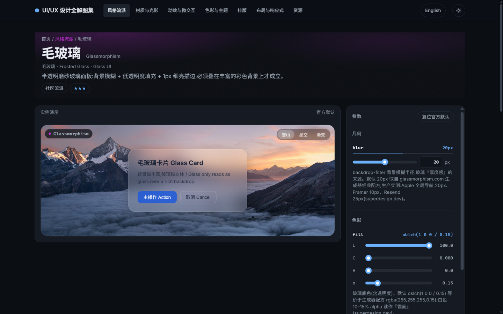
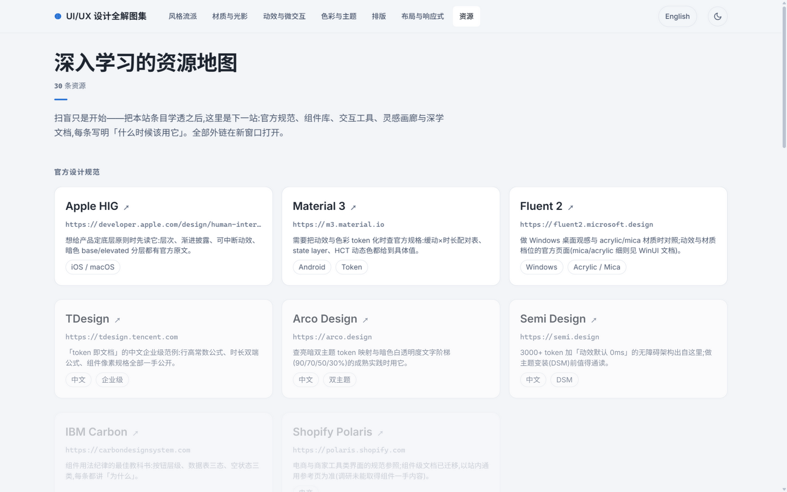
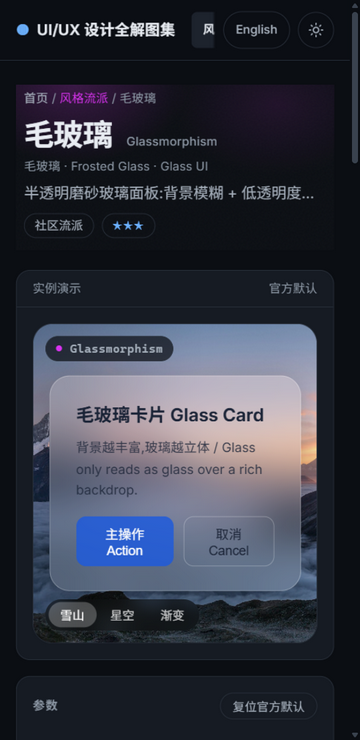

[English](README.en.md) | 简体中文

<div align="center">

# uiux-atlas · UI/UX 设计全解图集

**面向 AI Coding 用户 · 现代 UI/UX 设计全解图集 · Astro+React 参数化 Playground · 结构化复刻 Prompt**


> 灵感与设计语言源自五路设计研究(Apple HIG / TDesign / 字节 Arco+Semi / 画廊趋势 / 可复用代码),完整取舍记录见 [docs/design-spec.md](docs/design-spec.md)。

</div>

> [!IMPORTANT]
> 这是**设计学习图集**,不是组件库,也不提供生产级组件源码。每个条目的 demo 是**教学实现**:为讲清原理做了简化,不应原样搬进生产项目。

> [!WARNING]
> 平台专有材质——Fluent Acrylic / Fluent Mica / Liquid Glass / SwiftUI 材质等——在 Web demo 中是**近似复现**。官方不公布(或只公布部分)的数值,条目内均以「社区近似」如实标注,见 `materials/fluent-acrylic`、`materials/liquid-glass`、`materials/swiftui-materials` 等对应条目。

> [!CAUTION]
> 条目中的官方数值与浏览器支持状态核验于 **2026-11-20/21 调研时点**。规范与平台文档会漂移,使用前请以各官方文档站为准;每条条目的 `schema.json` 均附一手来源 URL(`sources` 字段)。

> [!NOTE]
> 纯静态站点:无后端、无账户体系、无追踪、无数据上传。所有交互(参数调节、prompt 生成、主题切换)均在浏览器本地完成。

## 📖 项目是什么

uiux-atlas 把现代前端的 UI/UX 设计知识点拆成 **43 个条目 × 6 大分类**(styles 7 / materials 12 / motion 11 / color 9 / type 3 / layout 1),每条目都由四要素构成:**① 可交互实例**(React 岛屿 demo,视觉即改即见)、**② 代码拆解**(双语四段讲解:结构与 DOM / 样式与参数 / 动效与交互 / 参数敏感度)、**③ 参数实时调节**(面板由条目 `schema.json` 自动生成控件,改动即时注入)、**④ 一键复刻 Prompt**(把当前参数快照浓缩成结构化 prompt,「复制复刻 Prompt」一键复制给任意 AI agent)。

条目数据模型是三件套,放在 `src/content/entries/{category}/{slug}/` 下:

| 文件 | 内容 |
|---|---|
| `schema.json` | 元数据 + 参数契约:名称(含中文 `nameZh`)、分类、来源体系、参数化星级(1–3★)、params(6 种类型)、场景/避免、a11y、浏览器支持、回退、`sources` 一手来源、`promptTemplate` |
| `zh.mdx` / `en.mdx` | 双语正文,按四段 h2 拆解,渲染进条目页 |
| `demo/Demo.tsx` | 可交互演示(React 岛屿),与参数面板共享同一 store |

## 📸 效果演示

**以下均为真实运行画面,非设计稿**:2026-11-21 摄于 `localhost:4321` 上的生产构建(`pnpm -C uiux-atlas run build` + preview)。每张截图的查看方式:`pnpm -C uiux-atlas dev` 后访问对应 URL 即可复现。

| 主题 | 页面 | 截图 | 复现 URL |
|---|---|---|---|
| 深色 | 首页(live hero 演示 + bento 分类) |  | `http://localhost:4321/` |
| 浅色 | 首页 |  | `http://localhost:4321/`(切浅色主题) |
| 深色 | 条目页 styles/glassmorphism(demo + 参数面板) |  | `http://localhost:4321/styles/glassmorphism/` |
| 浅色 | 条目页 styles/glassmorphism |  | `http://localhost:4321/styles/glassmorphism/`(切浅色主题) |
| 浅色 | 资源导航页(30 条 × 五组) |  | `http://localhost:4321/resources/` |
| 深色 | 条目页移动端 360px(demo 先行、面板紧随) |  | `http://localhost:4321/styles/glassmorphism/`(360px 视口) |

## ✨ 功能特性

| 功能 | 状态 | 说明 |
|---|---|---|
| 43 条目双语站点 | ✅ | 43 条目 × 中英双语 = 86 篇 MDX 正文;双语三层路由(zh 无前缀,en 在 `/en/`)+ 资源页,`astro build` 产出 102 页 |
| 参数面板 | ✅ | 由条目 `schema.json` 的 params 契约自动生成控件:滑杆 / OKLCH 四轴 / 贝塞尔曲线编辑器 / 分段按钮 / 阴影逐层;附「复位官方默认」 |
| 一键复刻 Prompt | ✅ | `store.exportSnapshot()` + `buildPrompt` 把参数快照浓缩为结构化 prompt;「复制复刻 Prompt」按钮一键复制。实弹测试:复刻代理仅凭 prompt 产出的 HTML 命中 **7/7** 关键参数(阈值 ≥5/7,`scripts/verify-prompt-test.mjs`) |
| 明暗双主题 | ✅ | 默认深色、浅色一等公民(语义层不变、值分主题);`localStorage("atlas-theme")` 持久化 + head 防闪烁脚本 + `theme-color` 双 meta;两套 token 对比度门禁 12/12 实算达标 |
| 资源导航 | ✅ | `/resources/` 与 `/en/resources/`:30 条资源 × 五组(官方规范 / 组件库 / 交互与动效工具 / 灵感画廊 / 深学文档),全部真实 URL、整卡外链 |
| 平台专有材质 | ⚠️ | Web 近似复现:`liquid-glass`(折射用 SVG `feDisplacementMap`)、`fluent-acrylic`(模糊半径未公布,blur 24px 为社区常见近似)、`swiftui-materials`(六档透明度/模糊为社区近似表,官方未公布数值)——条目内逐处标注 |
| SwiftUI API 面 | ⚠️ | `swiftui-spring`、`swiftui-materials` 等条目为**对照演示**:Web 端呈现参数语义与趋势,换真机仍以系统渲染为准 |
| 代码拆解 | ⚠️ | MVP 形态 = 高亮代码块 + 逐段注释(双语 MDX 四段 h2);教学叙事完整版(拆解↔内容联动的四段教学叙事)在 V1 规划(见路线图) |
| Prompt 校验 | ⚠️ | **本机代理指标**:7 项正则检查 + 阈值 ≥5/7,作为内部回归基线;非跨 agent 公开基准(prompt 质量无外部标准,蓝图已如实标注为工程推断) |
| 后端 / 账户 / 云同步 | ❌ 刻意不做 | 纯静态,无任何服务端 |
| MCP server | ❌ 刻意不做 | V2 规划(见路线图) |
| 实盘设计趋势抓取 | ❌ 刻意不做 | 内容为 2026-11-20/21 调研快照,不做实时趋势抓取(蓝图中的趋势季度自动化属 V2) |

### 非法输入行为契约

条目数据不是"宽容输入":每个 `schema.json` 都过 `src/lib/schema.ts` 的 zod 契约(经 `src/content.config.ts` 挂进 Astro 内容集合),**任何字段不合规 → `astro build` 直接失败,不会静默忽略**。在此之外,`scripts/verify-entries.mjs` 再做一层独立机器复检(43 条期望清单、双语字段非空、`sources` 必须 http(s) URL、params 逐类型的 shape、`nameZh` 覆盖),任一 problem 即 `exit 1`。

## 🧰 技术栈

| 层 | 选型 | 理由(详见 design-spec) |
|---|---|---|
| 框架 | Astro 5(`^5.7`,实测 5.18.2) | 内容站以静态为主,demo/面板/过滤按需水合为岛屿;双语 i18n 路由内建(zh 无前缀,en `/en/`);内容集合承担条目数据校验。选型出自蓝图「方案 C:Astro + token 管道」 |
| UI 运行时 | React 19 岛屿 | demo 组件、参数面板、过滤栏、Tabs、hero 迷你演示均为 React 岛屿;与 motion v12 生态同构 |
| 动效 | `motion` ^12 | JS 型参数(弹簧族)由同一 store 直接驱动;JS 弹簧统一官方默认 bounce 0.25 / damping 10(spec §2.6);静态动效一律纯 CSS 零 JS 化(spec §6c 移植规则) |
| 数据校验 | `zod` ^3.24 | 条目 schema 契约(6 种参数类型逐型校验);非法输入 → build 失败(见上方行为契约) |
| 样式 | 原生 CSS 语义 token(单文件 `src/styles/global.css`) | 深浅两主题共用语义层、值分主题(spec §2.1);无 Tailwind、无 CSS-in-JS,设计 token 即单一事实来源(spec §2 全表) |
| 字体 | 自托管 @fontsource:Inter Variable + Noto Sans SC(400/500/700) | 不引入 SF Pro(许可与跨平台一致性,spec §2.2);JetBrains Mono **未打包**,仅作 `--font-mono` 首选并回落系统等宽栈 |

## 🚀 快速开始

前置依赖:Node ≥ 18.17(Astro 5 基线;仓库锁定 `astro@5.18.2` 的 engines 为 `18.20.8 || ^20.3.0 || >=22.0.0`),pnpm ≥ 7.1(或 npm ≥ 9.6.5,engines 同样声明)。

```bash
# 在仓库工作区根(pnpm 工作区)执行;或进入 uiux-atlas/ 后去掉 -C 前缀
pnpm install                        # 安装依赖
```

| 命令 | 作用 | 门禁(不达标 `exit 1`) |
|---|---|---|
| `pnpm -C uiux-atlas dev` | 开发服务器(`http://localhost:4321`) | — |
| `pnpm -C uiux-atlas run build` | 全站静态构建到 `dist/` | 内容集合 zod 校验,不合规条目构建失败;本次实测 102 页 |
| `pnpm -C uiux-atlas exec astro check` | 类型检查 | 0 errors / 0 warnings 才过;本次实测 82 files,0/0 + 1 hint(`document.execCommand` 弃用提示,剪贴板降级方案兜底,属已知可接受项) |
| `pnpm -C uiux-atlas run check:contrast` | 双主题 WCAG 对比度门禁(`scripts/check-theme-contrast.mjs`) | 文本 ≥4.5:1、UI 组件 ≥3:1,共 12 组配对,任一不达标 `exit 1`;本次实测 12/12 达标 |
| `node uiux-atlas/scripts/verify-entries.mjs` | 条目完整性机器校验 | 43 条期望清单 + 结构/双语/来源 URL/参数 shape/`nameZh`,任一 problem `exit 1`;本次实测 `{"expected":43,"found":43,"problems":0}` |
| `node uiux-atlas/scripts/verify-dist.mjs` | 构建产物核验(先 build) | 双语三层路由 + 资源页共 102 页全产出、且含关键内容标记(含「复制复刻 Prompt」逐字文案),missing/contentFails > 0 即 `exit 1`;本次实测 `{"checked":102,"missing":0,"contentFails":0}` |
| `node uiux-atlas/scripts/verify-prompt-test.mjs` | Prompt 复刻实弹测试 | 检查 `out/prompt-test/glassmorphism.html`(复刻代理仅凭导出 prompt 产出的页面)是否命中 7 项关键参数,阈值 ≥5/7,不足 `exit 1`;本次实测 7/7 |

另有一次性脚本 `scripts/add-name-zh.mjs`(43 条 schema 注入中文 `nameZh`,幂等可重跑,映射键与磁盘条目双向核对,任一不匹配 `exit 1`)——日常开发无需运行,列入仅为完整性。

## 🎨 设计体系

站点自身即「吃自己的 dogfood」:首页 live 演示直接复用 `styles/glassmorphism` 条目的 demo 与 store。设计语言五条要点:

1. **双主题舞台**:默认深色、浅色一等公民;语义层不变、值分主题;两套底色均禁死黑死白(深色 `--bg #0b0e13` 带蓝 hue,浅色 `--bg #f3f5f8` 同 hue 取向)。
2. **层次三轴,不靠装饰**:层级只动字号/字重/颜色;全站可交互语义只有 `--accent` 一个蓝,六分类 accent 只出现在分类语义处。
3. **渐进披露**:讲解、规格、来源收进 Tabs/Accordion,默认收起、一步展开。
4. **密度是工作台的美德**:12–13px mono 数值 + tabular-nums;单页主要区块 ≤1.5 屏滚动内触达。
5. **动效有目的、可中断、可降级**:19 条巧思全部登记用途与 `prefers-reduced-motion` 降级行为,无降级方案的动效不合并。

对比度全部实算锁值:深色四级文本对 bg 16.45 / 8.90 / 6.43 / 4.18:1,浅色 14.29 / 7.00 / 4.94 / 3.17:1(禁用档豁免);由 `check:contrast` 门禁持续守护(12/12)。

**全文见 [docs/design-spec.md](docs/design-spec.md)(v2.3)**——单一事实来源:token 全表(色彩/字阶/间距/圆角/阴影/动效)、四张页面蓝图、组件规范、19 条巧思清单、趋势取舍与移植清单、响应式矩阵、无障碍红线。

## 📦 部署

纯静态产物,`dist/` 即全部;无适配器、无服务端需求,Cloudflare Pages 或任意静态托管均可。一条命令:

```bash
pnpm -C uiux-atlas run build        # 产出 uiux-atlas/dist/(本次实测 102 页)
```

Cloudflare Pages 参考配置:构建命令 `pnpm -C uiux-atlas run build`(工作区根)或 `pnpm run build`(设根目录为 `uiux-atlas/`),输出目录 `uiux-atlas/dist`。

## 📊 内容来源与口径

条目不是凭空写的:九路行业调研打底、五路设计研究定设计语言,来源映射逐条可追溯。以下调研产物位于 pnpm 工作区根的 `out/` 目录(上游调研工作区,不进入 `dist/` 构建产物):

| 来源 | 内容 | 口径 |
|---|---|---|
| `out/research/01–09` | 九路调研:行业报告 / 官方设计规范 / 视觉风格趋势 / 动效与微交互 / 布局与排版 / 色彩与主题 / 组件与模式 / 开源仓库 / 实现技术 | 2026-11-20/21 调研时点;一手来源逐条记录 |
| `out/design-study/01–05` | 五路设计研究:Apple HIG / TDesign / 字节 Arco+Semi / 画廊与趋势 / 可复用代码 | 汇成 `docs/design-spec.md` 的全部决策依据 |
| `out/mapping.json` | 43 条逐条来源映射(batch / id / researchRef / note,指向调研报告具体章节) | 批次分布:b0-seed 3 + b1a 6 + b1b 6 + b2 6 + b3a 5 + b3b 5 + b4a 4 + b4b 4 + b5 4 = 43 |
| 官方数值入库规则 | 条目参数默认值只收**经官方页面核实**的数值 | 未经官方页核实的不入库;社区近似值必须在条目内显式标注(见顶部 WARNING) |

## ⚠️ 已知局限

如实标注,与开发/评审报告口径一致(`out/build-report.md`、`out/redesign-report.md`、`out/round2-report.md`):

- **平台专有材质是 Web 近似**:Liquid Glass / Fluent Acrylic / SwiftUI 材质的官方未公布数值以社区近似呈现,条目内逐处标注;换真机以系统渲染为准。
- **来源 URL 可达性未全量复测**:评审抽查 6 条目共 16 个来源 URL,3/16 实测 200(Apple 域),其余 13 个因收尾环境本机网络出口限制未能连通(000 连接失败,非 HTTP 错误码;调研期间均抓取成功过)——**待外联恢复后复测**(复测命令:`curl -sL -o /dev/null -w "%{http_code}" <url>`)。
- **性能与实机验收未测**:Lighthouse/axe 扫描、360px 无横向滚动实测、`prefers-reduced-motion` 实机走查、主题切换 FOUC 录屏均未执行(design-spec 附录如实标注,round2 报告列为浏览器端留白)。
- **Shopify Polaris 组件级文档已迁移**:调研未能取得组件一手内容,资源页该条目已如实标注「以站内通用参考页为准」。
- **View Transitions 仅 Chromium 系完整支持**:跨文档视图过渡在 Firefox 等浏览器退回普通跳转,功能不破坏、无 morph。
- **趋势内容是快照**:全部条目与趋势判断基于 2026-11-20/21 调研时点,不做实时更新。
- **仓库卫生**:`src/out/` 下有一份误放的重构报告副本,待清理,不参与构建。

## 🗺 路线图

按蓝图(`out/blueprint-v1.md` 四要素演进表与里程碑)规划,均未开始:

**V1**

- [ ] 代码拆解升级为四段教学叙事完整版(当前为「高亮代码 + 逐段注释」MVP 形态)
- [ ] `llms.txt` 全站索引(供 AI agent 读结构化 spec)
- [ ] 参数快照分享(URL hash / 分享链接)

**V2**

- [ ] MCP server
- [ ] shadcn registry 发布
- [ ] "Open in v0"

**新内容域**

- [ ] 图标体系(约 8 条,现有调研未覆盖,需专项调研)
- [ ] 数据可视化配色(约 6 条,同上)

## 🧱 项目结构

```
uiux-atlas/
├── astro.config.mjs            # Astro 5 + React + MDX;i18n:zh 无前缀,en 在 /en/
├── package.json                # scripts:dev / build / preview / check / check:contrast
├── tsconfig.json               # astro/tsconfigs/strict + react-jsx + @/* 路径别名
├── docs/
│   ├── design-spec.md          # 设计语言规范 v2.3(单一事实来源)
│   └── screenshots/            # 六张真实运行截图(2026-11-21,生产构建)
├── scripts/                    # 校验脚本(用法见「快速开始」表格)
│   ├── check-theme-contrast.mjs  # 双主题 WCAG 对比度门禁(支持 hex/rgb/oklch)
│   ├── verify-entries.mjs        # 43 条期望清单 + 结构/双语/来源/参数 shape 校验
│   ├── verify-dist.mjs           # 102 页产物核验 + 关键内容标记(含按钮逐字文案)
│   ├── verify-prompt-test.mjs    # prompt 复刻实弹(7 项正则,阈值 ≥5/7)
│   └── add-name-zh.mjs           # 一次性:43 条 schema 注入 nameZh(幂等)
├── public/photos/              # 条目照片素材(Unsplash,见致谢)
└── src/
    ├── content.config.ts       # entries / entryBody 内容集合(zod 校验)
    ├── content/entries/{category}/{slug}/
    │   ├── schema.json         # 元数据 + 参数契约 + sources + promptTemplate
    │   ├── zh.mdx / en.mdx     # 双语四段拆解正文
    │   └── demo/Demo.tsx       # 可交互演示岛屿
    ├── components/             # React 岛屿 + Astro 视图
    │   ├── DemoStage.tsx       # 演示舞台(CSS 变量注入点)
    │   ├── ParamPanel.tsx      # 参数面板(schema 自动生成;OKLCH/贝塞尔/阴影编辑器)
    │   ├── PromptExport.tsx    # 「复制复刻 Prompt」导出
    │   ├── WorkbenchPanel.tsx  # 右栏组合(ParamPanel + PromptExport)
    │   ├── HeroGlassDemo.tsx   # 首页 hero live 迷你演示(复用 glassmorphism 条目)
    │   ├── BreakdownTabs.tsx   # MDX 四节的客户端 Tabs(渐进增强,无 JS 纵排)
    │   ├── FilterBar.tsx       # 列表页过滤(体系 × 星级,带计数)
    │   ├── DemoHost.tsx / HomeView.astro / CategoryView.astro /
    │   │   EntryDetail.astro / EntryCard.astro / MetaAccordion.astro
    ├── data/resources.ts       # 30 条资源 × 五组(逐条真实 URL,来源注于文件头)
    ├── i18n/ui.ts              # 双语 UI 文案字典
    ├── layouts/Base.astro      # 站点骨架(导航 / 主题切换 / head 防闪烁脚本)
    ├── lib/                    # store.ts(参数 store)/ prompt.ts(buildPrompt)/
    │   │                       #   schema.ts(zod 契约)/ types.ts / metas.ts /
    │   │                       #   urls.ts / displayName.ts(中文显示名)
    ├── pages/                  # zh(/)与 en(/en/):index / [category] / [slug] / resources
    └── styles/global.css       # 全部主题 token 与类名(深浅两套,单文件)
```

> 注:`src/out/` 下有一份误放的重构报告副本(待清理),不属于站点源码。

## 🙏 致谢

- **九路调研的全部一手来源**:Apple HIG、Material 3、Fluent 2、MDN/W3C、TDesign、Arco Design、Semi Design 等官方文档与生产站点实测——逐条清单见 `out/research/01–09` 与 `out/design-study/01–05` 各文来源节。
- **[Unsplash](https://unsplash.com)**:条目照片素材(`public/photos/glass-alps.jpg`、`glass-nebula.jpg`)。
- **[react-bits](https://reactbits.dev)** / **[Magic UI](https://magicui.design)**:聚光、磁吸按钮、Border Beam 等巧思的**思路参考**——按「抄实现思想、按本站 token 重写」移植,未复制组件源码;声明:react-bits、Magic UI 与本站无任何关联(无隶属、无赞助)。

## 📄 许可

- **demo 代码**:`demo/Demo.tsx` 与站点实现代码 —— **MIT**。
- **正文内容**:条目 `zh.mdx` / `en.mdx` 及站点文案 —— **CC BY-NC 4.0**(署名-非商业性使用)。
- 第三方图片素材仅在对应条目的 `schema.json` `sources` 中注明出处与授权方式,授权未确认的素材不入库。
- 所有参数数值均注明一手来源(见各条目 `schema.json` 的 `sources` 字段)。

> [!WARNING]
> 再次提醒:平台专有参数(Fluent Acrylic / Liquid Glass / SwiftUI 材质等)在本站 Web demo 中为**近似复现**,数值为调研时点记录;**官方值一律以各平台文档站为准**。
