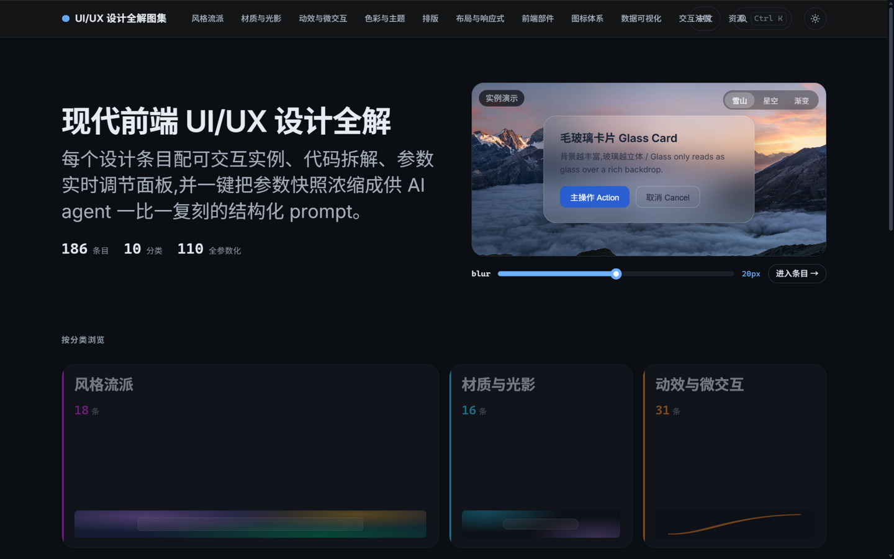
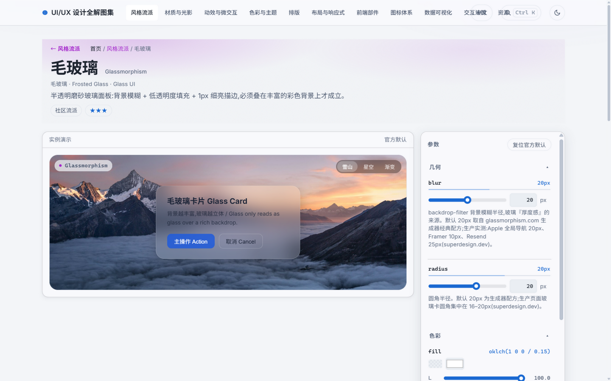
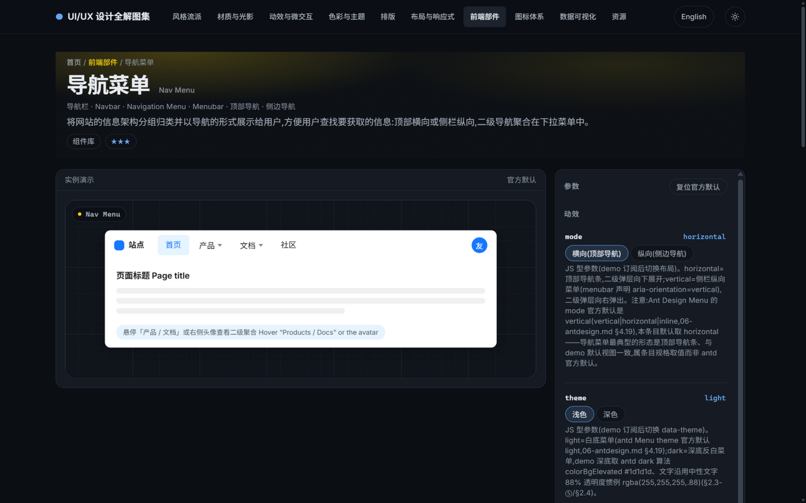

[English](README.en.md) | 简体中文

<div align="center">

# uiux-atlas · UI/UX 设计全解图集

**面向 AI Coding 用户 · 现代 UI/UX 设计全解图集 · Astro+React 参数化 Playground · 结构化复刻 Prompt**

[](#-技术栈)
[](#-项目是什么)
[](#-许可)

> 灵感与设计语言源自五路设计研究(Apple HIG / TDesign / 字节 Arco+Semi / 画廊趋势 / 可复用代码),完整取舍记录见 [docs/design-spec.md](docs/design-spec.md)。

</div>

> [!IMPORTANT]
> 这是**设计学习图集**,不是组件库,也不提供生产级组件源码。每个条目的 demo 是**教学实现**:为讲清原理做了简化,不应原样搬进生产项目。

> [!WARNING]
> 平台专有材质——Fluent Acrylic / Fluent Mica / Liquid Glass / SwiftUI 材质等——在 Web demo 中是**近似复现**。官方不公布(或只公布部分)的数值,条目内均以「社区近似」如实标注,见 `materials/fluent-acrylic`、`materials/liquid-glass`、`materials/swiftui-materials` 等对应条目。

> [!CAUTION]
> 条目中的官方数值与浏览器支持状态核验于 **2026-11-20/21 调研时点**。规范与平台文档会漂移,使用前请以各官方文档站为准;每条条目的 `schema.json` 均附一手来源 URL(`sources` 字段)。

> [!NOTE]
> 纯静态站点:无后端、无账户体系、无追踪、无数据上传。所有交互(参数调节、prompt 生成、主题切换)均在浏览器本地完成。

## 📖 项目是什么

uiux-atlas 把现代前端的 UI/UX 设计知识点拆成 **142 个条目 × 10 大分类**(styles 18 / materials 12 / motion 25 / color 14 / type 9 / layout 9 / components 24 / icons 8 / dataviz 8 / principles 15;参数化星级分布 3★ 84 / 2★ 57 / 1★ 1;总数 142 为 `node scripts/verify-entries.mjs` 本次实跑结果 `{"expected":142,"found":142,"problems":0}`,分项计数取自该脚本期望清单、星级分布逐条实扫各 `schema.json`),每条目都由四要素构成:**① 可交互实例**(React 岛屿 demo,视觉即改即见)、**② 代码拆解**(双语四段讲解:结构与 DOM / 样式与参数 / 动效与交互 / 参数敏感度)、**③ 参数实时调节**(面板由条目 `schema.json` 自动生成控件,改动即时注入)、**④ 一键复刻 Prompt**(把当前参数快照浓缩成结构化 prompt,「复制复刻 Prompt」一键复制给任意 AI agent)。

条目数据模型是三件套,放在 `src/content/entries/{category}/{slug}/` 下:

| 文件 | 内容 |
|---|---|
| `schema.json` | 元数据 + 参数契约:名称(含中文 `nameZh`)、分类、来源体系、参数化星级(1–3★)、params(6 种类型)、场景/避免、a11y、浏览器支持、回退、`sources` 一手来源、`promptTemplate` |
| `zh.mdx` / `en.mdx` | 双语正文,按四段 h2 拆解,渲染进条目页 |
| `demo/Demo.tsx` | 可交互演示(React 岛屿),与参数面板共享同一 store |

## 📸 效果演示

**以下九张均为真实运行画面,非设计稿**:摄于 2026-11-21/22 的 `localhost:4321` 生产构建(`pnpm -C uiux-atlas run build` + preview;其中八张为 2026-11-22 重拍版、dataviz 一张摄于 2026-11-21 晚)。每张截图的查看方式:`pnpm -C uiux-atlas dev` 后访问表中「复现 URL」——即每张图都可按同一 URL 一键复现。注:其中 6 张更新与 3 张新增截图已随提交 `a170451`(2026-11-22,feat(theme): 浅色主题现代化 v2.5)入库,`git status` 下已无未提交截图。另注:九张摄于 97 条目(V3)时点;全量补全批(principles 第十分类等,97 → 142)落地后,站点导航与首页分类卡已多出「交互法则」一项(本次实跑 `dist/index.html` 含该分类卡),页面形态以当前实跑构建为准,截图重拍待做。

| 主题 | 页面 | 截图 | 复现 URL |
|---|---|---|---|
| 深色 | 首页(live hero 演示 + bento 分类) |  | `http://localhost:4321/` |
| 浅色 | 首页 |  | `http://localhost:4321/`(切浅色主题) |
| 深色 | 条目页 styles/glassmorphism(demo + 参数面板) |  | `http://localhost:4321/styles/glassmorphism/` |
| 浅色 | 条目页 styles/glassmorphism |  | `http://localhost:4321/styles/glassmorphism/`(切浅色主题) |
| 深色 | 条目页 components/nav-menu(顶部导航 + 头像 hover 菜单) |  | `http://localhost:4321/components/nav-menu/` |
| 浅色 | 资源导航页(30 条 × 五组) |  | `http://localhost:4321/resources/` |
| 深色 | 趋势追踪页(兴起/退潮 + 口径标注) |  | `http://localhost:4321/trends/` |
| 深色 | 条目页 dataviz/dataviz-colorblind-safe(色盲安全四视图模拟) |  | `http://localhost:4321/dataviz/dataviz-colorblind-safe/` |
| 深色 | 条目页移动端 360px(demo 先行、面板紧随) |  | `http://localhost:4321/styles/glassmorphism/`(360px 视口) |

## ✨ 功能特性

| 功能 | 状态 | 说明 |
|---|---|---|
| 十分类 142 条目双语站点 | ✅ | 142 条目 × 中英双语 = 284 篇 MDX 正文;双语三层路由(zh 无前缀,en 在 `/en/`)+ 资源页、趋势页,`astro build` 产出 310 页(本次实测)。**条目/MDX 规模以本行 + `verify-entries` 门禁实测为权威口径**(本次实跑 `{"expected":142,"found":142,"problems":0}`);`docs/design-spec.md` 开头与附录的「43 条 × 86 MDX」为 MVP 时点遗留记录、历次升版未回填,不作为规模口径(见「设计体系」节说明) |
| 交互法则域(第十分类 `principles`,15 条) | ✅ | `fitts-law` / `hick-law` / `millers-law` / `jakobs-law` / `peak-end-rule` / `doherty-threshold`(交互节奏 <400ms)/ `teslers-law` / `gestalt-proximity` / `gestalt-similarity-closure` / `serial-position` / `von-restorff` / `apg-patterns`(W3C ARIA APG)/ `wcag-checklist` / `prefers-contrast` / `keyboard-navigation`;来源以 W3C(APG / WCAG 2.2)与 Laws of UX 为主,逐条见各 `schema.json` 的 `sources` 字段;verify-entries 本次实跑 principles 15/15;注:分类色 token `--cat-principles` 尚未在 `global.css` 定义,该分类页暂无分类色带(见「设计体系」要点 2 注) |
| 全量补全(97 → 142 条,九分类 → 十分类) | ✅ | 布局 +8(`anchor-positioning` / `subgrid` / `masonry-columns` / `grid-lanes` / `holy-grail` / `auto-fit-minmax` / `position-sticky` / `safe-area`)/ 排版 +6(`cjk-typography` / `text-wrap-balance` / `measure-line-length` / `wcag-text-spacing` / `font-display-strategy` / `drop-cap-initial`)/ 色彩与主题 +5(`p3-wide-gamut` / `semantic-token-layers` / `m3-tone-surfaces` / `color-psychology-ui` / `theme-transition`)/ 风格史 +3(`maximalism` / `classic-brutalism` / `spatial-ui`)/ 动效 +6(`m3-duration-tokens` / `easing-pairs` / `choreography` / `parallax` / `haptics-web` / `page-transitions`)/ dataviz +2(`dataviz-chart-selection` / `dataviz-color-ordering`),合计 45 条,与交互法则域 15 条共同收口全量;调研背书 `out/design-study/11-modern-completion.md`(「现代新概念补研(全量补全)」,2026-11-22,BCD 一手口径;§1 锚点定位 / §2 text-wrap balance / §4 瀑布流与 Grid Lanes / §5–§7 spatial-ui·经典粗野主义·极繁主义 / §8 主题切换过渡),其余条目逐条溯源各 `schema.json` `sources`;verify-entries 本次实跑 `{"expected":142,"found":142,"problems":0}`,build 本次实测 310 页 |
| Apple 材质层(参数化:中性色阶/采样模糊/叠色/内高光/细边框/焦点环统一参数) | ✅ | spec v2.6 §2.8:三档材质 token(`--mat-thin/regular/thick-*`:blur 12/20/28px × 叠色 tint α × 内高光 × 细边框 × 阴影,深浅两态)+ Apple 中性阶梯 `--ios-*`(systemGray 六阶等,官方值溯源 `out/design-study/09-apple-materials.md` §2)+ `.material` 工具类五面语义接入(站点 header / 过滤栏 / 参数面板 / 演示面板 / Prompt 导出框)+ 按压对 `--press-scale: 0.96` + 焦点环统一 `--focus-ring-*`(2px accent + offset 1px,apple.com 生产 CSS 逐字规格);落点 `src/styles/global.css`,`@supports` 门控回退,官方未公布量级如实标注;`check:contrast` 本次复跑 12/12 |
| 微交互域(按压反馈对/卡槽弹簧/浮层入场/指数衰减 shake/Toast 弹簧/阻尼感/丝滑工艺/滚动溢出) | ✅ | motion 分类 11 → 19:新增 8 条工艺/行为条目 `press-feedback`(按压反馈对)/ `slot-spring`(卡槽弹簧)/ `overlay-entrance`(浮层入场)/ `shake-decay`(错误抖动·指数衰减)/ `toast-spring`(Toast 弹簧入场)/ `damping-craft`(阻尼感设计)/ `smooth-craft`(丝滑工艺)/ `scroll-overflow`(滚动溢出行为),均带参数契约与 `prefers-reduced-motion` 降级;同批 styles 域 7 → 15(8 个风格史条目),另升级两条既有条目(toast 弹簧参数化、liquid-glass 折射/morph 参数化,见路线图 V3);verify-entries 本次实跑 142/142、build 本次实测 310 页 |
| 参数面板 | ✅ | 由条目 `schema.json` 的 params 契约自动生成控件:滑杆 / OKLCH 四轴 / 贝塞尔曲线编辑器 / 分段按钮 / 阴影逐层;附「复位官方默认」 |
| 一键复刻 Prompt | ✅ | `store.exportSnapshot()` + `buildPrompt` 把参数快照浓缩为结构化 prompt;「复制复刻 Prompt」按钮一键复制。实弹测试:复刻代理仅凭 prompt 产出的 HTML 命中 **7/7** 关键参数(阈值 ≥5/7,`scripts/verify-prompt-test.mjs`;本次重跑 7/7) |
| AI agent 通道(llms.txt + 条目 .md) | ✅ | `src/pages/llms.txt.ts` 静态端点:站点定位 + 十分类 + 全部条目清单(name / nameZh / URL / en 页 / md 链接);每条目另有 `/{分类}/{slug}/index.md` 纯文本版(`src/pages/[category]/[slug]/index.md.ts`)。本次实测 `dist/llms.txt` 落盘(178 行,含 `## principles 交互法则 / Principles (15)` 节)、`dist/styles/glassmorphism/index.md` 存在 |
| MCP server(四工具) | ✅ | `mcp/server.mjs`:零依赖 stdio JSON-RPC(协议依据 MCP spec 2025-03-26:initialize 握手含版本协商、tools/list / tools/call、JSON-RPC batch),只读各条目 `schema.json`;四工具 `search_entries` / `get_entry` / `build_prompt` / `list_categories`(build_prompt 的参数序列化与站内「复制复刻 Prompt」同源),Claude/Cursor 等 coding agent 以 `node mcp/server.mjs` 接入。门禁 `test:mcp`:initialize → tools/list → tools/call 四断言,本次实测 4/4 通过(协商版本 2025-03-26) |
| shadcn registry(24 件) | ✅ | 24 条「前端部件」demo 内联发布为 shadcn registry item + index(`public/registry/`,24 item + index.json 共 25 个文件;`pnpm run build` 后随 `dist/registry/` 静态发布,shadcn CLI/兼容客户端直接拉取);门禁 `verify:registry`,本次实测 `{"expected":24,"items":24,"problems":0}`;用法见「部署 → Registry 用法(Agent 消费)」 |
| Open in v0 | ✅ | 条目页「在 v0 打开」次级按钮(`src/components/PromptExport.tsx`):把当前复刻 Prompt `encodeURIComponent` 进 `https://v0.dev/chat?q=…` 新窗口打开并自动预填。URL 方案来源:官方 URL 参数文档已下线(现行 v0.app/docs 与 vercel.com/docs/v0 均无 URL 参数文档),方案按 2026-11-21 curl 行为实测核验(307 跳转链 `v0.dev/chat → v0.app` 一路保留 `q`,终页 RSC payload 含预填 prompt),属**官方未背书、行为验证**方案,失效时回退「复制 Prompt + 打开 v0 首页」(证据链见该文件头注) |
| 参数快照分享链接 | ✅ | `src/lib/shareLink.ts` 把当前参数快照序列化为 `#s=name=value&…` 追加到当前地址;「分享参数链接」按钮一键复制完整链接(`src/components/PromptExport.tsx`);打开链接时 `DemoStage` 挂载解析恢复——仅恢复 schema 中存在的参数,非法值过滤、数值按 min/max 收敛 |
| 内嵌对比度校验组件 | ✅ | `src/components/ContrastChecker.tsx` 附加面板渲染于 color 分类两条目(`color/oklch-workflow` / `color/wcag-contrast`)的演示舞台内(`src/components/DemoStage.tsx`):前景/背景实时实算 WCAG 对比度比值(`src/lib/color.ts` `contrastRatio`,与 wcag-contrast 条目同一实现) |
| @property 类型约束 | ✅ | `src/styles/global.css` 为示范条目 styles/glassmorphism 的参数变量声明 `@property` 类型(`--glass-blur` / `--glass-fill` / `--glass-border` / `--glass-radius`),变量未设也有类型化回退、不支持的浏览器整条自然跳过;count-up 条目的 `--num` 同法 |
| 明暗双主题 | ✅ | 默认深色、浅色一等公民(语义层不变、值分主题);`localStorage("atlas-theme")` 持久化 + head 防闪烁脚本 + `theme-color` 双 meta;两套 token 对比度门禁 12/12 实算达标 |
| 资源导航 | ✅ | `/resources/` 与 `/en/resources/`:30 条资源 × 五组(官方规范 / 组件库 / 交互与动效工具 / 灵感画廊 / 深学文档),全部真实 URL、整卡外链 |
| 趋势追踪页 | ✅ | `/trends/` 与 `/en/trends/`(`src/pages/trends.astro` + `src/data/trends.ts`):2023–2026 设计趋势「兴起/退潮」时点快照,逐条提炼自 `out/research/03-visual-style-trends.md` §二并注明出处与口径(份额类数据标注「单一 AI 设计工具请求份额,非市场采用率」);`relatedEntries` 站内互链有构建期守卫,写死死链直接构建失败;本次实测 build 产出两页(`dist/trends/`、`dist/en/trends/`) |
| 平台专有材质 | ⚠️ | Web 近似复现:`liquid-glass`(折射用 SVG `feDisplacementMap`)、`fluent-acrylic`(模糊半径未公布,blur 24px 为社区常见近似)、`swiftui-materials`(六档透明度/模糊为社区近似表,官方未公布数值)——条目内逐处标注 |
| SwiftUI API 面 | ⚠️ | `swiftui-spring`、`swiftui-materials` 等条目为**对照演示**:Web 端呈现参数语义与趋势,换真机仍以系统渲染为准 |
| 代码拆解 | ⚠️ | MVP 形态 = 高亮代码块 + 逐段注释(双语 MDX 四段 h2;`BreakdownTabs.tsx` 按 h2 分组为 tab);教学叙事完整版(拆解↔内容联动的四段教学叙事)未完成,见路线图未勾选项 |
| Prompt 校验 | ⚠️ | **本机代理指标**:7 项正则检查 + 阈值 ≥5/7,作为内部回归基线;非跨 agent 公开基准(prompt 质量无外部标准,蓝图已如实标注为工程推断) |

### 刻意不做(❌)

- **后端 / 账户 / 云同步**:纯静态,无任何服务端——学习图集不需要账户体系与云端状态,引入即违背「纯静态无追踪」承诺(见顶部 NOTE)。
- **实盘设计趋势抓取**:内容为 2026-11-20/21 调研快照,不做实时趋势抓取;趋势追踪页已落地为时点快照(见上表 ✅ 行),**脚本化刷新待做**(做法:重跑 `out/research/03` 的联网检索流程后替换 `src/data/trends.ts` 数值,统计口径与来源原文以 03 号调研为准;见路线图「季度刷新自动化」)。

### 非法输入行为契约

条目数据不是"宽容输入":每个 `schema.json` 都过 `src/lib/schema.ts` 的 zod 契约(经 `src/content.config.ts` 挂进 Astro 内容集合),**任何字段不合规 → `astro build` 直接失败,不会静默忽略**。在此之外,`scripts/verify-entries.mjs` 再做一层独立机器复检(142 条期望清单、双语字段非空、`sources` 必须 http(s) URL、params 逐类型的 shape、`nameZh` 覆盖),任一 problem 即 `exit 1`。

## 🧰 技术栈

| 层 | 选型 | 理由(详见 design-spec) |
|---|---|---|
| 框架 | Astro 5(`^5.7`,实测 5.18.2) | 内容站以静态为主,demo/面板/过滤按需水合为岛屿;双语 i18n 路由内建(zh 无前缀,en `/en/`);内容集合承担条目数据校验。选型出自蓝图「方案 C:Astro + token 管道」 |
| UI 运行时 | React 19 岛屿 | demo 组件、参数面板、过滤栏、Tabs、hero 迷你演示均为 React 岛屿;与 motion v12 生态同构 |
| 动效 | `motion` ^12 | JS 型参数(弹簧族)由同一 store 直接驱动;JS 弹簧统一官方默认 bounce 0.25 / damping 10(spec §2.6);静态动效一律纯 CSS 零 JS 化(spec §6c 移植规则) |
| 数据校验 | `zod` ^3.24 | 条目 schema 契约(6 种参数类型逐型校验);非法输入 → build 失败(见上方行为契约) |
| 样式 | 原生 CSS 语义 token(单文件 `src/styles/global.css`) | 深浅两主题共用语义层、值分主题(spec §2.1);无 Tailwind、无 CSS-in-JS,设计 token 即单一事实来源(spec §2 全表) |
| 字体 | 自托管 @fontsource:Inter Variable + Noto Sans SC(400/500/700) | 不引入 SF Pro(许可与跨平台一致性,spec §2.2);JetBrains Mono **未打包**,仅作 `--font-mono` 首选并回落系统等宽栈 |

## 🚀 快速开始

前置依赖:Node ≥ 18.17(Astro 5 基线)、pnpm ≥ 7.1(或 npm ≥ 9.6.5)——以上数字来自 **`astro` 包的 engines 声明**(本仓库锁定 `astro@5.18.2`,其 engines 为 `node 18.20.8 || ^20.3.0 || >=22.0.0`、`npm >=9.6.5`、`pnpm >=7.1.0`;本仓库自身 package.json 未另设 engines 字段)。

```bash
# 在仓库根(即 uiux-atlas/ 目录内)执行;
# 若你在上游目录操作,下方命令表统一带 pnpm -C uiux-atlas 前缀,在 uiux-atlas/ 内时去掉该前缀即可
pnpm install                        # 安装依赖
```

| 命令 | 作用 | 门禁(不达标 `exit 1`) |
|---|---|---|
| `pnpm -C uiux-atlas dev` | 开发服务器(`http://localhost:4321`) | — |
| `pnpm -C uiux-atlas run build` | 全站静态构建到 `dist/` | 内容集合 zod 校验,不合规条目构建失败;本次实测 310 页(24.23s) |
| `pnpm -C uiux-atlas exec astro check` | 类型检查 | 0 errors / 0 warnings 才过;本次实测 193 files,0/0 + 2 hint(`document.execCommand` 弃用提示,剪贴板降级方案兜底;`motion/parallax` demo 一处未用局部变量,纯演示代码——均属已知可接受项,`astro check` exit 0) |
| `pnpm -C uiux-atlas run check:contrast` | 双主题 WCAG 对比度门禁(`scripts/check-theme-contrast.mjs`) | 文本 ≥4.5:1、UI 组件 ≥3:1,共 12 组配对,任一不达标 `exit 1`;本次实测 12/12 达标 |
| `node uiux-atlas/scripts/verify-entries.mjs` | 条目完整性机器校验 | 142 条期望清单 + 结构/双语/来源 URL/参数 shape/`nameZh`,任一 problem `exit 1`;本次实测 `{"expected":142,"found":142,"problems":0}` |
| `node uiux-atlas/scripts/verify-dist.mjs` | 构建产物核验(先 build) | 双语三层路由(10 分类 ×2 + 142 条目 ×2)+ 首页/资源页/趋势页共 310 页全产出、且含关键内容标记(含「复制复刻 Prompt」逐字文案),missing/contentFails > 0 即 `exit 1`;本次实测 `{"checked":310,"missing":0,"contentFails":0}` |
| `node uiux-atlas/scripts/verify-prompt-test.mjs` | Prompt 复刻实弹测试 | 检查 `out/prompt-test/glassmorphism.html`(复刻代理仅凭导出 prompt 产出的页面)是否命中 7 项关键参数,阈值 ≥5/7,不足 `exit 1`;本次实测 7/7 |
| `pnpm -C uiux-atlas run generate:registry`(生成)→ `pnpm -C uiux-atlas run verify:registry`(门禁) | shadcn registry 发布件:24 条「前端部件」demo 内联为 registry item JSON + index(JSON 数组),输出到 `public/registry/`(build 随 dist 发布;用法见「部署 → Registry 用法(Agent 消费)」) | 24 个 item JSON 可解析、`name`/`type`/`files[].path`/`content` 非空、无残留 `@/` import、index 与 item 数一致,任一不达标 `exit 1`;本次实测 `{"expected":24,"items":24,"problems":0}` |
| `node uiux-atlas/scripts/test-mcp-server.mjs`(或 `pnpm -C uiux-atlas run test:mcp`) | MCP server(stdio JSON-RPC)冒烟测试:spawn `mcp/server.mjs`,驱动 initialize → tools/list → tools/call 序列,供 Claude/Cursor 等 coding agent 检索图集 | 四断言:initialize 响应含 capabilities、tools/list 含四工具(search_entries / get_entry / build_prompt / list_categories)、get_entry(glassmorphism) 含「毛玻璃」、build_prompt(参数覆盖 blur=30) 含 blur 30px;任一失败打印明细并 `exit 1`;本次实测 4/4 通过 |

另有一次性脚本 `scripts/add-name-zh.mjs`(首批 43 条 schema 注入中文 `nameZh`,幂等可重跑,映射键与磁盘条目双向核对,任一不匹配 `exit 1`;后落地条目的 `nameZh` 随条目直接编写,142 条全覆盖由 verify-entries 把关)——日常开发无需运行,列入仅为完整性。

## 🎨 设计体系

站点自身即「吃自己的 dogfood」:首页 live 演示直接复用 `styles/glassmorphism` 条目的 demo 与 store。设计语言五条要点:

1. **双主题舞台**:默认深色、浅色一等公民;语义层不变、值分主题;两套底色均禁死黑死白(深色 `--bg #0b0e13` 带蓝 hue,浅色 `--bg #f3f5f8` 同 hue 取向)。
2. **层次三轴,不靠装饰**:层级只动字号/字重/颜色;全站可交互语义只有 `--accent` 一个蓝,十分类 accent 只出现在分类语义处(注:`--cat-principles` 分类色 token 尚未在 `global.css` 定义,principles 分类页当前不带分类色带,待随 spec 升版补齐)。
3. **渐进披露**:讲解、规格、来源收进 Tabs/Accordion,默认收起、一步展开。
4. **密度是工作台的美德**:12–13px mono 数值 + tabular-nums;单页主要区块 ≤1.5 屏滚动内触达。
5. **动效有目的、可中断、可降级**:19 条巧思全部登记用途与 `prefers-reduced-motion` 降级行为,无降级方案的动效不合并。

对比度全部实算锁值:深色四级文本对 bg 16.45 / 8.90 / 6.43 / 4.18:1,浅色 14.29 / 7.00 / 4.94 / 3.17:1(第四档为禁用/占位档,AA 豁免);由 `check:contrast` 门禁持续守护(12/12)。

**全文见 [docs/design-spec.md](docs/design-spec.md)(v2.6)**——单一事实来源,**范围限定于设计决策**:token 全表(色彩/字阶/间距/圆角/阴影/动效)+ 材质层统一参数表(§2.8,v2.6 新增:三档材质 × 深浅两态 + 中性色阶 + 焦点环)、**五张页面蓝图**(§4:首页 / 列表页 / 条目页 / 资源导航页 / 趋势追踪页,第五张为 v2.4 回填)、组件规范、19 条巧思清单、趋势取舍与移植清单、响应式矩阵、无障碍红线。**条目规模不在其 SSOT 范围内**,权威口径 = 本 README 的 **142 条目 × 284 篇 MDX**(`verify-entries` 门禁实测把关);design-spec 开头「43 个条目 × 86 个 MDX」与其附录验证记录、§4.1「六分类 bento」均为 MVP 时点(v1.0–v2.2)遗留表述,历次升版未回填(round5 报告已建议升版补齐),条目规模数字以本 README 为准。

## 📦 部署

纯静态产物,`dist/` 即全部;无适配器、无服务端需求,Cloudflare Pages 或任意静态托管均可。一条命令:

```bash
pnpm -C uiux-atlas run build        # 产出 uiux-atlas/dist/(本次实测 310 页)
```

Cloudflare Pages 参考配置:构建命令 `pnpm -C uiux-atlas run build`(工作区根)或 `pnpm run build`(设根目录为 `uiux-atlas/`),输出目录 `uiux-atlas/dist`。

### Registry 用法(Agent 消费)

24 条「前端部件」的 demo 另发布为 shadcn registry 格式,`pnpm run build` 后随 `dist/registry/` 静态发布,shadcn CLI/兼容客户端可直接拉取:

- **索引**:`public/registry/index.json` —— JSON 数组,轻量条目(`name`/`type`/`title`/`description`/`files`/`meta`,不含 content);build 后位于 `dist/registry/index.json`。
- **单件**:`public/registry/{slug}.json`(如 `button.json`,24 个,`type=registry:component`)——`files[].path` 保留源站路径 `src/content/entries/components/{slug}/demo/Demo.tsx` 作溯源,Demo.tsx 全文内联于 `files[].content`,`meta` 透传 `nameZh`/`star`/`subgroup`,`dependencies` 留空(react 由消费端按自身版本声明)。
- **拉取**:`npx shadcn@latest add https://<host>/registry/button.json`,或自行 GET 该 URL 后解析 `files[].content`。
- **诚实标注**:每件均为**教学演示件,非生产组件**——demo 原依赖的三个本站内部模块(`@/lib/store` 参数 store、`@/lib/types` 类型、`@/components/DemoStage` 演示舞台)在消费端不可用,生成器已把这三处 `@/` import 原位改写为「[registry 改写]」注释并注明替代方式(本地受控 state + 自有舞台容器);文件体内对应引用需按注释替换后才能编译运行。

再生成与门禁:`pnpm -C uiux-atlas run generate:registry` → `pnpm -C uiux-atlas run verify:registry`(见上方命令表)。

## 📊 内容来源与口径

条目不是凭空写的:九路行业调研打底、五路设计研究定设计语言,后落地批次另配六份专项研究(06–11:AntD 组件 / 图标 / dataviz / Apple 材质 / 微交互代码 / 现代新概念补研·全量补全),来源映射逐条可追溯。以下调研产物位于上游调研工作区的 `out/` 目录(与 `uiux-atlas/` 平级;不入库、不进入 `dist/` 构建产物):

| 来源 | 内容 | 口径 |
|---|---|---|
| `out/research/01–09` | 九路调研:行业报告 / 官方设计规范 / 视觉风格趋势 / 动效与微交互 / 布局与排版 / 色彩与主题 / 组件与模式 / 开源仓库 / 实现技术 | 2026-11-20/21 调研时点;一手来源逐条记录 |
| `out/design-study/01–05` | 五路设计研究:Apple HIG / TDesign / 字节 Arco+Semi / 画廊与趋势 / 可复用代码 | 汇成 `docs/design-spec.md` 的全部决策依据 |
| `out/design-study/06–11` | 六份专项调研:06 Ant Design 组件 props 一手值(components 24 条)/ 07 图标体系五套开源图标集(icons 8 条)/ 08 数据可视化配色与图表基础(dataviz 域打底首批 6 条)/ 09 Apple 材质一手实测(spec v2.6 依据)/ 10 微交互代码八条(V3 motion 工艺条目)/ 11 现代新概念补研·全量补全(§1 锚点定位 / §2 text-wrap balance / §4 瀑布流与 Grid Lanes / §5–§7 spatial-ui·经典粗野主义·极繁主义 / §8 主题切换过渡) | 06–08 于 2026-11-21,09–11 于 2026-11-22;一手来源逐条记录 |
| `out/mapping.json` | 67 条逐条来源映射(batch / id / researchRef / note,指向调研报告具体章节) | 批次分布:首批 b0-seed 3 + b1a 6 + b1b 6 + b2 6 + b3a 5 + b3b 5 + b4a 4 + b4b 4 + b5 4 = 43,+ components b6-basic 4 + b6-form 5 + b6-feedback 5 + b6-data 4 + b6-navigation 4 + b6-other 2 = 24,合计 67;icons 8 + dataviz 6 条未入 mapping,来源逐条见各条目 `schema.json` 的 `sources` 字段 |
| 官方数值入库规则 | 条目参数默认值只收**经官方页面核实**的数值 | 未经官方页核实的不入库;社区近似值必须在条目内显式标注(见顶部 WARNING) |

## ⚠️ 已知局限

如实标注,与全部八轮开发/评审报告口径一致:上游工作区 `out/` 下有 `build-report.md`、`redesign-report.md`、`round2-report.md`、`round3-report.md`、`round7-report.md`、`round8-report.md`(不入库);`out/round4-report.md`、`round5-report.md`、`round6-report.md` 已入库于本仓库 `out/`。以下条目经 round4–6 复核后仍逐条成立(round6 标注的 spec SSOT 缺口已由 design-spec v2.4 关闭;round7 为 README 信任契约同步、round8 为 V3 材质层/微交互/风格域落地报告,未推翻上述口径):

> [!WARNING]
> - **平台专有材质是 Web 近似**:Liquid Glass / Fluent Acrylic / SwiftUI 材质的官方未公布数值以社区近似呈现,条目内逐处标注;换真机以系统渲染为准。
> - **来源 URL 可达性——「待复测」已清零,不再是未决项**:评审抽查 6 条目共 16 个来源 URL,已由 round5 报告(`out/round5-report.md` §三)实跑 `curl -sL -o /dev/null -w "%{http_code}" --max-time 20` 全量复测:**16/16 全部 200、unreachable 0**,早期「3/16 实测 + 13 条待复测」口径作废(round6 报告 §三曾沿用该旧口径,与本条冲突处以 round5 实测记录为准);本次门禁修复再按同命令复测 16 条,仍全部 200。残留口径:来源页内容随官方文档漂移,条目引用数值仍以调研时点(2026-11-20/21)记录为准。
> - **性能与实机验收未测**:Lighthouse/axe 扫描、360px 无横向滚动实测、`prefers-reduced-motion` 实机走查、主题切换 FOUC 录屏均未执行(design-spec 附录如实标注,round2 报告列为浏览器端留白)。

> [!NOTE]
> - **Shopify Polaris 组件级文档已迁移**:调研未能取得组件一手内容,资源页该条目已如实标注「以站内通用参考页为准」(`src/data/resources.ts`)。
> - **View Transitions 仅 Chromium 系完整支持**:跨文档视图过渡在 Firefox 等浏览器退回普通跳转,功能不破坏、无 morph。
> - **趋势内容是时点快照**:全部条目与趋势判断基于 2026-11-20/21 调研时点,不做实时更新;季度刷新自动化未做(见路线图)。
> - **仓库卫生**:`src/out/` 下有一份误放的重构报告副本,待清理,不参与构建。

## 🗺 路线图

按蓝图(`out/blueprint-v1.md` 四要素演进表与里程碑)规划。已完成项逐项打勾、与提交链一一对应:`11a5d2b`(MVP 43 条目)→ `f18fce6`(移动端过滤条修复)→ `85e4c45`/`83ece35`(V1:icons + dataviz 两域)→ `fa10bf9`(V2:agent 消费通道 + 趋势页)→ `3842635`(spec v2.4,关闭 round6 SSOT 缺口)→ `7bc672e`/`a170451`(spec v2.5 + 浅色主题现代化;后者同时将 6 张更新与 3 张新增截图入库)→ `d5e295a`(V3:Apple 材质层 spec v2.6 + styles 域扩至 15 + motion 域扩至 19 + toast / liquid-glass 两条既有条目升级)→ 当前工作区(全量补全:新第十分类 principles 交互法则 15 条 + b10 布局 8 / b11 排版 6 / b12 色彩 5 / b13 风格史 3 / b14 动效 6 / dataviz 2,97 → 142;尚未提交,故无提交号);未完成项保持未勾选:

**V1**

- [ ] 代码拆解升级为四段教学叙事完整版(当前为「高亮代码 + 逐段注释」MVP 形态;`BreakdownTabs.tsx` 按 h2 分组为 tab)
- [x] `llms.txt` 全站索引(供 AI agent 读结构化 spec)——已落地:另附每条目 `.md` 纯文本端点(`dist/llms.txt` 本次实测存在,178 行,含十分类清单)
- [x] 参数快照分享(URL hash / 分享链接)——已落地:`#s=` 分享链接,「分享参数链接」一键复制、打开即恢复

**V2**

- [x] MCP server——已落地:`mcp/server.mjs` 零依赖 stdio JSON-RPC(协议依据 MCP spec 2025-03-26),四工具 `search_entries` / `get_entry` / `build_prompt` / `list_categories`,门禁 `test:mcp` 本次实测 4/4(接入方式见「快速开始」命令表)
- [x] shadcn registry 发布——已落地:`public/registry/`(index.json + 24 item,`generate:registry` 生成 / `verify:registry` 门禁,build 随 dist 发布;用法见「部署 → Registry 用法(Agent 消费)」)
- [x] "Open in v0"——已落地:条目页「在 v0 打开」,复刻 Prompt 经 `?q=` 新窗口预填;URL 方案无官方文档背书,按 2026-11-21 curl 行为实测核验(证据链见 `src/components/PromptExport.tsx` 头注)
- [x] 趋势追踪页——已落地:`/trends/` 双语页(2023–2026 兴起/退潮时点快照,数据提炼自 `out/research/03-visual-style-trends.md` §二,文件 `src/data/trends.ts`)
- [ ] MCP 真实客户端注册走查——当前仅有 `test:mcp` stdio 冒烟断言,尚未在 Claude/Cursor 等真实客户端完成注册与工具调用端到端走查
- [ ] Lighthouse / axe 性能与无障碍实机验收——当前为浏览器端留白(见「已知局限」)

**V3**

- [x] Apple 材质层——已落地:spec v2.6 §2.8 材质层统一参数表(三档 mat-thin/regular/thick × 深浅两态:采样模糊/叠色/内高光/细边框/阴影)+ `--ios-*` 中性色阶 + `.material` 五面语义接入 + 按压对 + 焦点环统一,全部数值溯源 `out/design-study/09-apple-materials.md`;`check:contrast` 本次复跑 12/12
- [x] 微交互域 8 条(motion 11 → 19)——已落地:`press-feedback` / `slot-spring` / `overlay-entrance` / `shake-decay` / `toast-spring` / `damping-craft` / `smooth-craft` / `scroll-overflow`,verify-entries 本次实跑 142/142(全量补全批后全集口径)
- [x] 风格域扩至 15(styles 7 → 15)——已落地:8 个风格史条目 `flat-design` / `skeuomorphism` / `memphis-design` / `swiss-international` / `editorial-magazine` / `frutiger-aero` / `y2k-retro-futurism` / `holographic-chrome`
- [x] 两条既有条目升级——已落地:`components/toast` 增 stiffness/damping 弹簧参数对(Motion 源码默认逐字核验)、`materials/liquid-glass` 增 refraction 位移与 morph(胶囊舱/展开面板)参数;toast 属 24 件 registry 发布件之一,已重跑 `generate:registry` + `verify:registry`(本次实测 24/24)

**新内容域**

- [x] 图标体系(8 条已落地 `icons` 分类;专项调研 `out/design-study/07-icons.md`)
- [x] 数据可视化配色(8 条已落地 `dataviz` 分类:08 号专项调研打底首批 6 条,全量补全批新增 `dataviz-chart-selection` / `dataviz-color-ordering` 2 条;专项调研 `out/design-study/08-dataviz.md`)
- [x] 全量条目——已落地:142 条 × 10 分类,verify-entries 期望清单即 142 条、本次实跑全部命中(`{"expected":142,"found":142,"problems":0}`);构成:第十分类 principles 交互法则 15 + b10 布局 8 / b11 排版 6 / b12 色彩 5 / b13 风格史 3 / b14 动效 6 / dataviz 2(97 → 142);调研背书 `out/design-study/11-modern-completion.md`(「现代新概念补研(全量补全)」)+ 各条目 `schema.json` `sources` 逐条溯源。蓝图演进表「160 条全量」(M7–M12 里程碑)与本路线图旧表述「170 条」均为规划时点估算,落地全集以 verify-entries 期望清单 142 条为权威口径
- [ ] 趋势数据季度刷新自动化——当前为时点快照,手工刷新做法见功能表 ❌ 行(重跑 `out/research/03` 流程后替换 `src/data/trends.ts`)

## 🧱 项目结构

```
uiux-atlas/
├── astro.config.mjs            # Astro 5 + React + MDX;i18n:zh 无前缀,en 在 /en/
├── package.json                # scripts:dev / build / preview / check / check:contrast / generate:registry / verify:registry / test:mcp
├── tsconfig.json               # astro/tsconfigs/strict + react-jsx + @/* 路径别名
├── docs/
│   ├── design-spec.md          # 设计语言规范 v2.6(单一事实来源;五张页面蓝图 + §2.8 材质层)
│   └── screenshots/            # 九张真实运行截图(2026-11-21/22,生产构建)
├── out/                        # 评审报告 round4–6(已入库;round2/3 与 build/redesign 报告在上游工作区 out/)
├── scripts/                    # 校验脚本(用法见「快速开始」表格)
│   ├── check-theme-contrast.mjs  # 双主题 WCAG 对比度门禁(支持 hex/rgb/oklch)
│   ├── verify-entries.mjs        # 142 条期望清单 + 结构/双语/来源/参数 shape 校验
│   ├── verify-dist.mjs           # 310 页产物核验 + 关键内容标记(含按钮逐字文案)
│   ├── verify-prompt-test.mjs    # prompt 复刻实弹(7 项正则,阈值 ≥5/7)
│   ├── generate-registry.mjs     # 24 条部件 demo → shadcn registry item + index(public/registry/)
│   ├── verify-registry.mjs       # registry 发布件门禁(可解析/必填字段/index 数一致)
│   ├── test-mcp-server.mjs       # MCP server 冒烟测试(initialize → tools/list → tools/call 四断言)
│   └── add-name-zh.mjs           # 一次性:首批 43 条 schema 注入 nameZh(幂等)
├── mcp/
│   └── server.mjs               # MCP server(零依赖 stdio JSON-RPC;四工具,见「快速开始」test:mcp 行)
├── public/photos/              # 条目照片素材(Unsplash,见致谢)
├── public/registry/            # shadcn registry 发布件(index.json + 24 item;build 随 dist)
└── src/
    ├── content.config.ts       # entries / entryBody 内容集合(zod 校验)
    ├── content/entries/{category}/{slug}/
    │   ├── schema.json         # 元数据 + 参数契约 + sources + promptTemplate
    │   ├── zh.mdx / en.mdx     # 双语四段拆解正文
    │   └── demo/Demo.tsx       # 可交互演示岛屿
    ├── components/             # React 岛屿 + Astro 视图
    │   ├── DemoStage.tsx       # 演示舞台(CSS 变量注入点 + `#s=` 分享参数恢复)
    │   ├── ParamPanel.tsx      # 参数面板(schema 自动生成;OKLCH/贝塞尔/阴影编辑器)
    │   ├── PromptExport.tsx    # 「复制复刻 Prompt」导出 + 「分享参数链接」+「在 v0 打开」
    │   ├── ContrastChecker.tsx # 内嵌对比度校验(color 分类两条目舞台内)
    │   ├── WorkbenchPanel.tsx  # 右栏组合(ParamPanel + PromptExport)
    │   ├── HeroGlassDemo.tsx   # 首页 hero live 迷你演示(复用 glassmorphism 条目)
    │   ├── BreakdownTabs.tsx   # MDX 四节的客户端 Tabs(渐进增强,无 JS 纵排)
    │   ├── FilterBar.tsx       # 列表页过滤(体系 × 星级,带计数)
    │   ├── DemoHost.tsx / HomeView.astro / CategoryView.astro /
    │   │   EntryDetail.astro / EntryCard.astro / MetaAccordion.astro
    ├── data/resources.ts       # 30 条资源 × 五组(逐条真实 URL,来源注于文件头)
    ├── data/trends.ts          # 趋势追踪页数据(2023–2026 时点快照,提炼自 out/research/03 §二)
    ├── i18n/ui.ts              # 双语 UI 文案字典
    ├── layouts/Base.astro      # 站点骨架(导航 / 主题切换 / head 防闪烁脚本)
    ├── lib/                    # store.ts(参数 store)/ prompt.ts(buildPrompt)/
    │   │                       #   schema.ts(zod 契约)/ shareLink.ts(#s= 分享链接)/
    │   │                       #   color.ts(WCAG 对比度实算)/ types.ts / metas.ts /
    │   │                       #   urls.ts / displayName.ts(中文显示名)
    ├── pages/                  # zh(/)与 en(/en/):index / [category] / [slug] / resources / trends
    │   │                       #   + llms.txt.ts 与 [slug]/index.md.ts(agent 纯文本端点)
    └── styles/global.css       # 全部主题 token 与类名(深浅两套,单文件)
```

> 注:`src/out/` 下有一份误放的重构报告副本(待清理),不属于站点源码。

## 🙏 致谢

- **九路调研与各专项调研的全部一手来源**:Apple HIG、Material 3、Fluent 2、MDN/W3C、TDesign、Arco Design、Semi Design 等官方文档与生产站点实测——逐条清单见 `out/research/01–09` 与 `out/design-study/01–08` 各文来源节。
- **[Unsplash](https://unsplash.com)**:条目照片素材(`public/photos/glass-alps.jpg`、`glass-nebula.jpg`)。
- **[react-bits](https://reactbits.dev)** / **[Magic UI](https://magicui.design)**:聚光、磁吸按钮、Border Beam 等巧思的**思路参考**——按「抄实现思想、按本站 token 重写」移植,未复制组件源码;声明:react-bits、Magic UI 与本站无任何关联(无隶属、无赞助)。

## 📄 许可

- **demo 代码**:`demo/Demo.tsx` 与站点实现代码 —— **MIT**。
- **正文内容**:条目 `zh.mdx` / `en.mdx` 及站点文案 —— **CC BY-NC 4.0**(署名-非商业性使用)。
- 第三方图片素材仅在对应条目的 `schema.json` `sources` 中注明出处与授权方式,授权未确认的素材不入库。
- 所有参数数值均注明一手来源(见各条目 `schema.json` 的 `sources` 字段)。

> [!WARNING]
> 再次提醒:平台专有参数(Fluent Acrylic / Liquid Glass / SwiftUI 材质等)在本站 Web demo 中为**近似复现**,数值为调研时点记录;**官方值一律以各平台文档站为准**。
